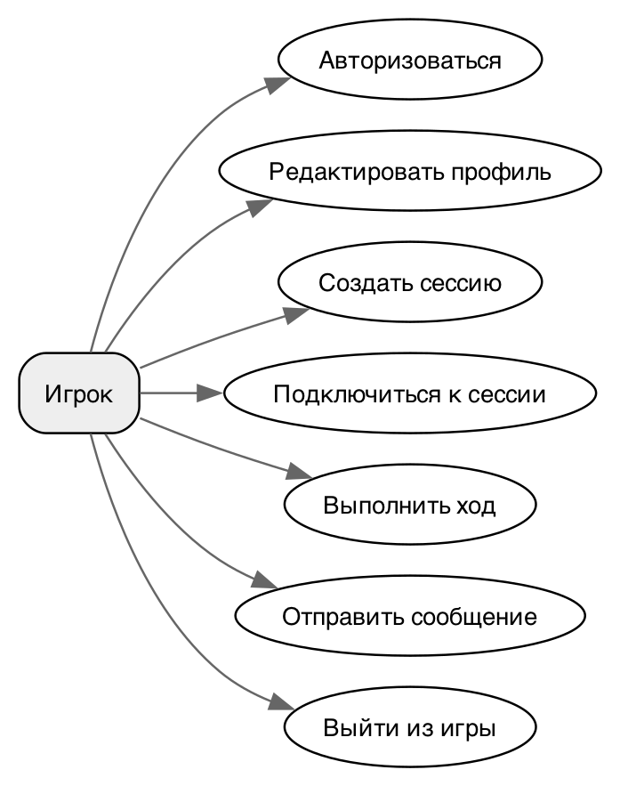
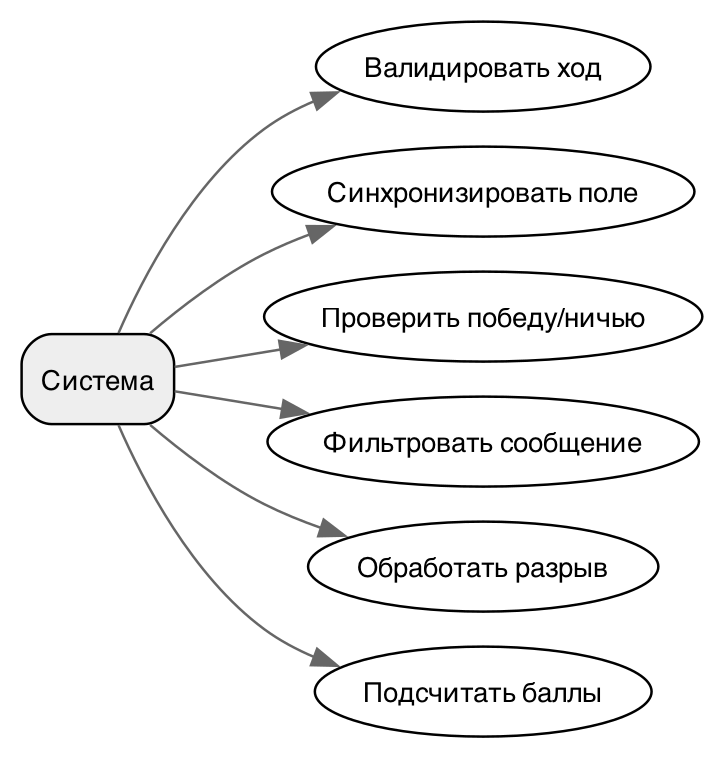
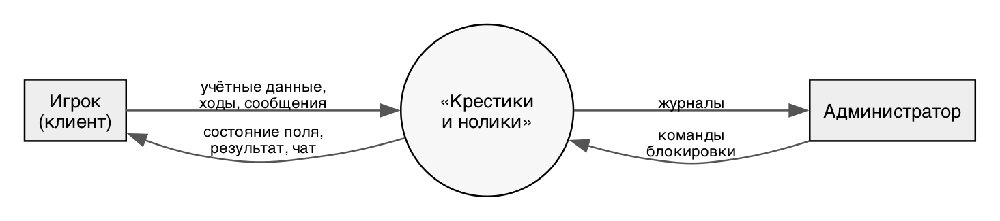
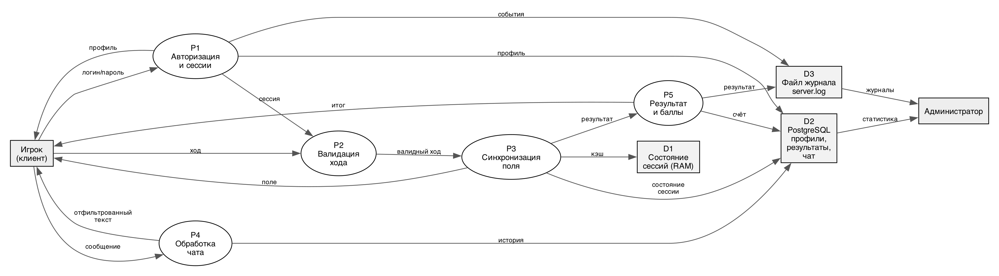

# Анализ предметной области

## 1. ОБЩЕЕ ОПИСАНИЕ ПРЕДМЕТНОЙ ОБЛАСТИ И ГРАНИЦ ПРОЕКТА

### 1.1. Характеристика предметной области

Предметная область проекта — организация многопользовательского сетевого взаимодействия в реальном времени. Система — программный комплекс с клиент-серверной архитектурой: серверная часть реализуется на языке C# с использованием платформы .NET 10, клиентская — на Flutter (Dart), хранение данных — в PostgreSQL, обмен — по протоколу TCP/IP в формате JSON.

Основное назначение системы — обеспечение надёжной синхронизации игрового состояния между двумя участниками сессии в классической игре «Крестики и нолики», а также организация сопутствующего текстового обмена (чат) с фильтрацией нежелательного контента. Дополнительно система обеспечивает авторизацию, ведение профилей, создание игровых сессий и подключение по идентификатору, автоматический подсчёт баллов и формирование итогового счёта.

Система функционирует в распределённой сетевой среде: каждый участник (клиент) подключается к центральному узлу (серверу) посредством постоянного сокетного соединения на базе протокола TCP/IP. Сервер выступает единственным источником истины относительно актуального состояния игрового поля. Клиентское приложение не принимает самостоятельных решений о допустимости игровых действий, а только формирует запросы и отображает результаты их обработки.

Оперативное состояние активных игровых сессий хранится в памяти сервера, а учётные записи, профили, результаты завершённых партий и история сообщений — в базе данных PostgreSQL. Такое разделение позволяет быстро обрабатывать ходы и одновременно сохранять данные после завершения партии.

Правила игры задают поле 25 × 25 клеток. Игроки по очереди ставят символы X и O; первый ход принадлежит создателю сессии. Побеждает тот, кто первым построит пять своих символов подряд по горизонтали, вертикали или диагонали. Если свободные клетки закончились, а победы нет, фиксируется ничья. Партия не ограничена таймером; при выходе одного из игроков или потере связи сессия отменяется, а баллы не начисляются.

Жизненный цикл сессии включает состояния Waiting (ожидание второго игрока), Active (идёт партия), Finished (есть победитель или ничья) и Cancelled (сессия отменена). Переходы между состояниями выполняет только сервер; клиент отображает текущее состояние и не может изменить его в обход протокола.

Предметная область ограничена сетевыми партиями двух игроков на поле 25 × 25. Система не претендует на замену промышленных игровых платформ: её ценность — в наглядной демонстрации полного цикла клиент-серверного взаимодействия, включая авторизацию, создание сессии, синхронизацию состояния, чат и подсчёт результата. Все игровые действия проходят через сервер, поэтому клиент не может самостоятельно изменить поле или результат.

К предметной области относятся также профили игроков, статистика побед и поражений, итоговый счёт и история сообщений. Эти данные не участвуют в реальном времени, но необходимы для сохранения результата между партиями и отображения прогресса пользователя.

### 1.2. Границы проекта

В область проекта включено:

• игровое поле 25 × 25 и проверка условия победы «пять в ряд»;

• разработка серверной части (Backend) на C# / .NET 10 — обработка подключений, авторизация, создание сессий, валидация ходов, синхронизация поля, чат и подсчёт результата;

• разработка клиентской части (Frontend) на Flutter — экраны авторизации, лобби, игрового поля, чата, профиля и результатов;

• реализация транспортного уровня на базе TCP/IP с передачей JSON-сообщений;

• ведение профилей пользователей и хранение результатов партий в PostgreSQL;

• механизм фильтрации текстовых сообщений чата;

• обработка нештатных ситуаций: занятая клетка, ход не в очередь, выход игрока, разрыв соединения, некорректные пакеты;

• автоматический подсчёт баллов и формирование итогового счёта.

Из области проекта исключено:

• мини-игра для определения права первого хода;

• список друзей и социальные функции;

• игровые сессии более чем для двух участников;

• разработка трёхмерной графики и сложных игровых движков;

• интеграция с платёжными системами и внешними сервисами;

• администрирование физической серверной инфраструктуры.

Допущения проекта: локальная сеть считается доверенной; соединение не защищено TLS; сервер и база данных развёрнуты через Docker Compose; клиенты работают под Windows 10/11; PostgreSQL имеет версию 15 или выше; TCP-порт сервера — 5000. Автоматическое переподключение к начатой партии и восстановление сессий после аварийного завершения сервера не предусмотрены.

### 1.3. Глоссарий и сокращения

В документе используются термины: клиент — приложение игрока; сервер — центральный узел, хранящий состояние; сессия — изолированная партия двух игроков; ход — координаты клетки, отправленные на сервер; DFD — диаграмма потоков данных; IDEF0 — функциональная модель; TCP/IP — транспортный протокол; JSON — формат обмена; PostgreSQL — система хранения данных.

Сокращения: ПК — персональный компьютер; БД — база данных; API — программный интерфейс; UI — пользовательский интерфейс; RAM — оперативная память. Термины используются в одном значении во всех разделах документа.

## 2. ЗАИНТЕРЕСОВАННЫЕ СТОРОНЫ (СТЕЙКХОЛДЕРЫ)

На этапе анализа требований идентифицированы следующие заинтересованные стороны, взаимодействующие с системой.

Данные приведены в таблице 1.

Таблица 1 — Заинтересованные стороны системы

| № | Стейкхолдер | Роль в системе | Основные интересы |
| --- | --- | --- | --- |
| 1 | Игрок (клиент) | Конечный пользователь | Стабильное соединение, честная игра, удобный интерфейс |
| 2 | Администратор | Эксплуатация и контроль | Доступ к журналам, блокировка учётных записей |
| 3 | Разработчик | Сопровождение системы | Читаемость кода, документированность протокола |

Игрок — физическое лицо, запускающее клиентское приложение на Flutter. Проходит авторизацию, создаёт игровую сессию или подключается к ней, передаёт координаты выбранной клетки и отправляет сообщения в чат. Игрок — первичный источник входных данных.

Сервер — не стейкхолдер: это центральный компонент системы на C# / .NET 10. Он принимает входящие пакеты, проверяет учётные данные, валидирует ходы по правилам игры, обновляет состояние поля и рассылает его обоим участникам, а также выполняет фильтрацию сообщений и подсчёт результата.

Администратор — пользователь с расширенными привилегиями. Просматривает журналы событий и блокирует учётные записи через командную строку; отдельной панели администратора и управления активными сессиями не предусмотрено.

Разработчик — специалист, сопровождающий серверную и клиентскую части. Использует документацию по протоколу и структуре базы данных.

Интересы стейкхолдеров частично противоречат друг другу: игрок ждёт быстрого отклика и простого интерфейса, администратор — надёжности, защиты учётных записей и понятных журналов, разработчик — сопровождаемости кода и стабильного протокола. Компромисс выбран в пользу серверной проверки всех действий и минимального клиента: интерфейс остаётся простым, а безопасность и целостность данных обеспечиваются на сервере.

Стейкхолдеры взаимодействуют через разные каналы: игрок — через клиентское приложение и чат; администратор — через командную строку, журналы и PostgreSQL; разработчик — через исходный код, схему БД и протокол. Такое разделение важно для анализа требований: интерфейс игрока не должен зависеть от административных функций, а сервер обязан оставаться единственным источником истины.

## 3. ОБЗОР СУЩЕСТВУЮЩИХ РЕШЕНИЙ (АНАЛОГИ)

Анализ предметной области включает обзор существующих программных продуктов аналогичного класса для обоснования архитектурных решений разрабатываемой системы.

### 3.1. Промышленные сетевые фреймворки (Photon Engine, Mirror Networking)

Преимущества:

• высокая масштабируемость и поддержка большого числа одновременных соединений;

• встроенные механизмы компенсации задержек и синхронизации;

• готовые решения для управления комнатами и matchmaking.

Недостатки:

• избыточный функционал для двухпользовательской игры «Крестики и нолики»;

• высокий порог вхождения и необходимость адаптации под учебный проект;

• зависимость от сторонней инфраструктуры.

### 3.2. Браузерные многопользовательские реализации на WebSocket

Преимущества:

• кроссплатформенность без установки клиентского приложения;

• мгновенный запуск через браузер;

• широкая доступность для пользователей.

Недостатки:

• отсутствие полноценных профилей и истории результатов;

• ограниченные возможности фильтрации контента на прикладном уровне;

• зависимость от стабильности браузерного соединения.

### 3.3. Позиционирование разрабатываемой системы

Разрабатываемая система занимает промежуточную нишу. В отличие от промышленных сетевых фреймворков она проектируется под конкретную предметную область без избыточных абстракций. В отличие от браузерных реализаций она обеспечивает профили пользователей, создание игровых сессий и подключение по идентификатору, сохранение результатов в базе данных и серверную фильтрацию сообщений. При этом система остаётся достаточно простой для реализации в рамках учебного проекта.

Сравнение аналогов проводилось по критериям: наличие сетевой партии, профилей, чата, фильтрации, серверной валидации и сложность развёртывания. Промышленные фреймворки выигрывают по масштабируемости, но проигрывают по простоте; браузерные реализации выигрывают по доступности, но обычно не имеют профилей и серверной фильтрации. Разрабатываемая система занимает нишу между ними: она проще промышленных платформ, но функциональнее типовых браузерных игр.

### 3.4. Выводы по аналогам

Проведённый обзор показывает, что промышленные сетевые фреймворки избыточны для двухпользовательской игры, а браузерные реализации обычно не обеспечивают профили, серверную валидацию и фильтрацию сообщений. Разрабатываемая система занимает промежуточное положение: она достаточно проста для сопровождения, но реализует полный набор функций, необходимых для оценки 5 в одиночной разработке.

Выбранный стек C# / Flutter / PostgreSQL позволяет показать и сетевую логику, и современный интерфейс, и хранение данных. Благодаря этому проект становится показательным для дисциплины «Технология разработки программного обеспечения» и удобным для демонстрации на защите.

Сравнение проводилось по шести критериям: наличие сетевой партии, профилей пользователей, чата, серверной фильтрации сообщений, серверной валидации ходов и сложность развёртывания. Промышленные фреймворки лидируют по масштабируемости, но избыточны для учебного проекта; браузерные реализации доступны, но обычно не имеют профилей и серверной фильтрации. Разрабатываемая система занимает среднее положение: она проще промышленных платформ, но функциональнее типовых браузерных игр.

## 4. ИНФОРМАЦИОННОЕ И ФУНКЦИОНАЛЬНОЕ МОДЕЛИРОВАНИЕ

Для формализованного описания процессов системы применяется комплекс CASE-технологий структурного анализа: методология функционального моделирования IDEF0, методология анализа потоков данных DFD, а также диаграммы вариантов использования UML Use Case.

### 4.1. Диаграмма вариантов использования (UML Use Case)

Диаграмма вариантов использования описывает внешнее поведение системы глазами её актёров. Основной актёр — Игрок; функции серверной части показаны как варианты использования системы.

Схема приведена на рисунке 1.

Рисунок 1 — Варианты использования актёра «Игрок»

Схема приведена на рисунке 2.

Рисунок 2 — Функции серверной части системы

Основные варианты использования и сценарии их выполнения приведены в таблице 2.

Таблица 2 — Варианты использования системы

| Актёр | Вариант использования | Предусловие | Основной поток | Постусловие |
| --- | --- | --- | --- | --- |
| Игрок | Авторизоваться | Клиент запущен, сеть доступна | 1. Вводит логин и пароль. 2. Сервер проверяет данные. 3. Клиент получает профиль. | Игрок авторизован, открыто главное меню |
| Игрок | Редактировать профиль | Игрок авторизован | 1. Открывает профиль. 2. Изменяет данные. 3. Сохраняет. | Профиль обновлён в базе данных |
| Игрок | Создать игровую сессию | Игрок авторизован | 1. Создаёт комнату. 2. Сервер присваивает идентификатор. 3. Ожидает соперника. | Сессия создана, игрок — хост |
| Игрок | Подключиться к сессии | Сессия существует | 1. Вводит идентификатор. 2. Устанавливается TCP-соединение. 3. Получает состояние поля. | Оба игрока в активной сессии |
| Игрок | Выполнить ход | Очередь хода принадлежит игроку | 1. Выбирает клетку. 2. Клиент отправляет координаты. 3. Сервер валидирует и рассылает поле. | Поле обновлено у обоих, очередь передана |
| Игрок | Отправить сообщение | Игрок в активной сессии | 1. Вводит текст. 2. Клиент отправляет. 3. Сервер фильтрует и рассылает. | Сообщение отображается у обоих |
| Игрок | Выйти из игры | Игрок в активной сессии | 1. Нажимает «Выйти». 2. Сервер уведомляет соперника. | Продолжение партии заблокировано |
| Система | Валидировать ход | — | Проверка координат, занятости клетки и очерёдности. | Валидный ход или код ошибки |
| Система | Синхронизация поля | — | Обновление состояния и рассылка обоим клиентам. | Актуальное поле у обоих |
| Система | Проверить победу и ничью | — | Проверка линий из пяти символов по горизонтали, вертикали и диагонали, а также свободных клеток. | Статус партии |
| Система | Фильтровать сообщение | — | Нормализация текста и замена запрещённых слов. | Текст после фильтра |
| Система | Подсчитать баллы | Партия завершена | Начисление баллов и запись результата в PostgreSQL. | Итоговый счёт сохранён |
| Игрок | Зарегистрироваться | Клиент запущен, сеть доступна | 1. Вводит логин, пароль и никнейм. 2. Сервер проверяет уникальность логина. 3. Создаёт учётную запись. | Учётная запись создана, выполнен вход |
| Игрок | Просмотреть статистику | Игрок авторизован | 1. Открывает профиль. 2. Сервер возвращает статистику. 3. Отображает данные. | Статистика отображена |
| Игрок | Просмотреть результат | Партия завершена | 1. Клиент получает result. 2. Показывает победителя и баллы. 3. Предлагает новую партию. | Результат показан обоим игрокам |
| Игрок | Выйти из сессии | Игрок в активной сессии | 1. Нажимает «Выйти». 2. Сервер отменяет сессию. 3. Соперник получает уведомление. | Сессия отменена, баллы не начислены |

Продолжение таблицы 2.

| Актёр | Вариант использования | Предусловие | Основной поток | Постусловие |
| --- | --- | --- | --- | --- |
| Система | Зарегистрировать пользователя | Логин свободен | Создание записи в Users и UserProfiles, хеширование пароля. | Учётная запись сохранена |
| Система | Аутентифицировать | Логин и пароль получены | Поиск пользователя, проверка хеша, проверка блокировки. | Профиль и идентификатор соединения |
| Система | Создать игровую сессию | Игрок авторизован | Выделение идентификатора, запись GameSessions, назначение хоста. | Сессия создана |
| Система | Проверить очередь | Получен пакет хода | Сравнение идентификатора игрока с текущей очередью. | Ход принят или отклонён |
| Система | Проверить координаты | Получен пакет хода | Проверка диапазона 0–24 и занятости клетки. | Координаты допустимы или код ошибки |
| Система | Обновить поле | Ход валиден | Запись символа X или O в клетку, смена очереди. | Новое состояние поля |
| Система | Обновить статистику | Партия завершена | Начисление 3/1/0 баллов, обновление UserProfiles и GameResults. | Статистика сохранена |
| Система | Записать журнал | Событие или ошибка | Формирование записи с датой, кодом, сессией и пользователем. | Запись в /app/logs/server.log |
| Система | Обработать ошибку | Некорректный пакет | Определение кода ошибки, возврат сообщения, сохранение состояния. | Клиент получил код и текст ошибки |
| Игрок | Создать новую партию | Партия завершена | 1. Нажимает «Новая партия». 2. Сервер создаёт сессию. 3. Игрок ожидает соперника. | Новая сессия создана |
| Игрок | Отменить ожидание | Сессия в состоянии Waiting | 1. Нажимает «Отмена». 2. Сервер закрывает сессию. 3. Клиент возвращается в лобби. | Сессия отменена |
| Система | Проверить уникальность логина | Регистрация | Поиск логина в Users. | Логин свободен или занят |
| Система | Проверить пароль | Вход | Сравнение хеша введённого пароля с сохранённым. | Пароль верен или отклонён |
| Система | Заблокировать учётную запись | Команда администратора | Установка признака блокировки в Users. | Вход запрещён |
| Система | Прочитать настройки | Запуск сервера | Чтение переменных окружения и параметров подключения. | Конфигурация загружена |
| Система | Записать сообщение | Сообщение прошло фильтр | Вставка записи в ChatMessages. | Сообщение сохранено |

Продолжение таблицы 2.

| Актёр | Вариант использования | Предусловие | Основной поток | Постусловие |
| --- | --- | --- | --- | --- |
| Система | Завершить сессию | Результат или выход игрока | Обновление статуса GameSessions и очистка ресурсов. | Сессия закрыта |
| Система | Обработать разрыв | — | Фиксация потери связи, уведомление соперника, завершение сессии. | Сессия корректно завершена |

Детализация вариантов использования показывает, что авторизация и создание сессии выполняются один раз, а ход и сообщение чата — многократно в течение партии. Для каждого варианта определены предусловие, основной поток и постусловие; ошибочные ветви возвращают клиенту код и не изменяют состояние поля. За счёт этого проще строить тестовые сценарии и проверять граничные случаи.

### 4.2. Диаграммы потоков данных (DFD)

### 4.2.1. Контекстная диаграмма DFD (уровень 0)

На контекстном уровне вся система представлена единым функциональным блоком «Программный комплекс „Крестики и нолики“», взаимодействующим с внешними сущностями.

Схема приведена на рисунке 3.

Рисунок 3 — DFD, контекстная диаграмма (уровень 0)

### 4.2.2. Декомпозиция DFD (уровень 1)

На первом уровне декомпозиции центральный блок раскрывается в совокупность взаимосвязанных процессов.

Внешние сущности:

• [E1] Клиентское приложение (Игрок) — источник и потребитель данных;

• [E2] Администратор — потребитель журналов и статистики.

Функциональные процессы:

• [P1] Авторизация и управление сессиями — проверка учётных данных, создание и закрытие игровых комнат;

• [P2] Валидация хода — проверка координат, занятости клетки и очерёдности;

• [P3] Синхронизация поля — обновление состояния и рассылка обоим участникам;

• [P4] Обработка чата — приём текста, фильтрация и рассылка;

• [P5] Результат и баллы — проверка победы/ничьей, начисление баллов, запись в БД.

Хранилища данных:

• [D1] Оперативный кэш сессий — текущее поле и очередь хода (RAM сервера);

• [D2] PostgreSQL — состояние активных сессий, профили, результаты партий, история сообщений.

• [D3] Файл журнала /app/logs/server.log — события, ошибки, неудачные попытки входа.

Схема приведена на рисунке 4.

Рисунок 4 — DFD, уровень 1 (декомпозиция)

Основные потоки данных системы приведены в таблице 3.

Таблица 3 — Основные потоки данных

| Поток | Источник | Приёмник | Содержание |
| --- | --- | --- | --- |
| Запрос авторизации | [E1] | [P1] | Логин и пароль |
| Данные профиля | [P1] | [E1] | Идентификатор, никнейм, статистика |
| Создание сессии | [E1] | [P1] | Параметры игровой комнаты |
| Идентификатор сессии | [P1] | [E1] | Номер комнаты и никнейм хоста |
| Пакет хода | [E1] | [P2] | Координаты клетки (строка, столбец) |
| Валидированный ход | [P2] | [P3] | Координаты и символ игрока |
| Состояние поля | [P3] | [E1] | Снимок поля, очередь, статус партии |
| Сообщение чата | [E1] | [P4] | Текст и идентификатор отправителя |
| Текст после фильтра | [P4] | [E1] | Текст без запрещённых слов |
| Результат партии | [P3] | [P5] | Победитель или ничья |
| Состояние сессии | [P3] | [D2] | Поле, очередь, статус |
| Запись результата | [P5] | [D2] | Баллы, статистика, итог |
| Журнал событий | [P1]–[P5] | [D3] | Записи о событиях и ошибках |
| Статистика | [D2] | [E2] | Сводные данные для администратора |
| Запрос регистрации | [E1] | [P1] | Логин, пароль, никнейм |
| Ответ регистрации | [P1] | [E1] | Профиль или код ошибки |

Продолжение таблицы 3.

| Поток | Источник | Приёмник | Содержание |
| --- | --- | --- | --- |
| Запрос статистики | [E1] | [P1] | Идентификатор пользователя |
| Статистика профиля | [P1] | [E1] | Победы, поражения, ничьи, счёт |
| Запрос результата | [E1] | [P3] | Идентификатор сессии |
| Результат партии | [P3] | [E1] | Победитель, ничья, баллы |
| Запись сессии | [P1] | [D2] | Участники, статус, дата создания |
| Чтение сессии | [D2] | [P2] | Поле, очередь, статус |
| Запись сообщения | [P4] | [D2] | Отфильтрованный текст, автор, время |
| История чата | [D2] | [E1] | Сообщения текущей сессии |
| Код ошибки | [P2] | [E1] | Номер и текст ошибки |
| Блокировка учётной записи | [P1] | [D2] | Признак блокировки |
| Запрос новой партии | [E1] | [P1] | Идентификатор игрока |
| Подтверждение создания | [P1] | [E1] | Идентификатор новой сессии |
| Отмена ожидания | [E1] | [P1] | Идентификатор сессии |
| Уведомление об отмене | [P1] | [E1] | Статус Cancelled |
| Чтение профиля | [D2] | [P1] | Никнейм и статистика |
| Обновление профиля | [P1] | [D2] | Новый никнейм |

Продолжение таблицы 3.

| Поток | Источник | Приёмник | Содержание |
| --- | --- | --- | --- |
| Журнал событий | [D3] | [E2] | Записи о событиях и ошибках |

На уровне DFD процесс валидации хода разделён на приём пакета, проверку координат и очереди, обновление поля, проверку победы и рассылку состояния. Такое разделение позволяет локализовать ошибки: если поле не обновилось у соперника, проблема находится на этапе рассылки, а не валидации. Хранилище D1 содержит оперативное состояние сессий, D2 — профили и историю, D3 — файл журнала.

### 4.3. Функциональная модель IDEF0

Методология IDEF0 применяется для отображения структуры и функций системы с соблюдением правила ICOM и иерархии декомпозиции.

### 4.3.1. Контекстная диаграмма IDEF0 (A-0)

Схема приведена на рисунке 5.

Рисунок 5 — IDEF0, контекстная диаграмма A-0

Входы: действия игрока (выбор клетки, сообщения чата, запросы на подключение), сетевые пакеты. Управление: правила игры, регламент таймаутов, политика фильтрации, требования безопасности. Механизмы: серверное оборудование, TCP/IP, C# / .NET 10, Flutter, PostgreSQL. Выходы: состояние поля, результат сессии, сообщения чата, журналы.

### 4.3.2. Декомпозиция A1

Схема приведена на рисунке 6.

Рисунок 6 — IDEF0, декомпозиция A1

Декомпозиция центральной функции A0 приведена в таблице 4.

Таблица 4 — Декомпозиция функции A1

| Блок | Функция | Вход | Управление | Выход | Механизм |
| --- | --- | --- | --- | --- | --- |
| A1.1 | Подключение и авторизация | Логин, пароль | Учётные данные, права | Профиль, идентификатор соединения | TCP-сокет, PostgreSQL |
| A1.2 | Сессии и подключение по ID | Запрос комнаты | Правила сессий | Идентификатор сессии | Серверная логика, RAM |
| A1.3 | Валидация и обмен полем | Координаты клетки | Правила игры, очередь | Новое поле, ошибка | Модуль валидации, RAM |
| A1.4 | Чат и фильтрация | Текст сообщения | Словарь запрещённых слов | Текст после фильтра | ChatService |
| A1.3.1 | Принять и разобрать пакет | Сетевой пакет | Формат JSON | Структура команды | TCP-сокет, JSON-парсер |
| A1.3.2 | Проверить очередь | Идентификатор игрока | Правила очерёдности | Допуск или отказ | GameSession |
| A1.3.3 | Проверить координаты | Строка и столбец | Диапазон 0–24, занятость | Допуск или код ошибки | GameBoard |
| A1.3.4 | Применить ход | Валидные координаты | Символ игрока | Новое поле | GameBoard |
| A1.3.5 | Проверить победу | Новое поле | Пять в ряд | Победитель, ничья или продолжение | WinChecker |
| A1.3.6 | Разослать состояние | Новое поле и статус | Формат сообщения | Сообщение state обоим | TCP-сокет |
| A1.3.7 | Записать результат | Победитель и баллы | Правила 3/1/0 | Запись GameResults | ScoreService, PostgreSQL |
| A1.1.1 | Проверить учётные данные | Логин и пароль | Хеш пароля | Профиль или отказ | UserRepository |
| A1.1.2 | Создать профиль | Логин, пароль, никнейм | Уникальность логина | Запись Users | UserRepository |
| A1.2.1 | Выделить идентификатор | Запрос комнаты | Свободные номера | Идентификатор сессии | SessionManager |
| A1.2.2 | Подключить второго игрока | Идентификатор сессии | Два участника | Активная сессия | SessionManager |
| A1.5.1 | Начислить баллы | Результат партии | Правила 3/1/0 | Обновлённая статистика | ScoreService |

Продолжение таблицы 4.

| Блок | Функция | Вход | Управление | Выход | Механизм |
| --- | --- | --- | --- | --- | --- |
| A1.5 | Результат и разрывы | Статус партии, сигнал таймаута | Правила начисления баллов | Итог, запись в БД | ScoreService, PostgreSQL |

### 4.3.3. Декомпозиция блока A1.3

Связи ICOM для блока A1.3: вход — координаты клетки и идентификатор сессии; управление — правила игры, очередь хода и диапазон 0–24; выход — новое состояние поля или код ошибки; механизм — модуль валидации, GameBoard и TCP-сокет. Для блока A1.5 управлением служат правила начисления баллов, входом — результат партии и сигнал таймаута, выходом — запись в PostgreSQL и итоговое сообщение клиентам.

## 5. АНАЛИЗ РИСКОВ И НЕШТАТНЫХ СИТУАЦИЙ

Специфика сетевого программирования требует описания аварийных сценариев и механизмов реагирования на них.

### 5.1. Матрица рисков

Матрица рисков приведена в таблице 5.

Таблица 5 — Матрица рисков и нештатных ситуаций

| № | Нештатная ситуация | Вероятность | Критичность | Стратегия реагирования |
| --- | --- | --- | --- | --- |
| R1 | Разрыв соединения с клиентом во время партии | Высокая | Высокая | Фиксация потери связи, уведомление соперника, корректное завершение сессии |
| R2 | Выход игрока из партии | Средняя | Высокая | Блокировка продолжения партии, уведомление соперника |
| R3 | Ход в занятую клетку | Высокая | Средняя | Сервер отклоняет пакет и возвращает код ошибки |
| R4 | Ход не в свою очередь | Средняя | Средняя | Сервер отклоняет пакет, фиксирует событие в журнале |
| R6 | Переполнение буфера приёма | Средняя | Высокая | Ограничение размера пакета, закрытие соединения, запись в журнал |
| R7 | Ошибка подключения к PostgreSQL | Средняя | Высокая | Повторные попытки, журнал, остановка сервера при неустранимой ошибке |
| R8 | Некорректный JSON | Высокая | Средняя | Отклонение пакета, возврат кода ошибки, сохранение состояния |
| R9 | Попытка третьего игрока подключиться к сессии | Средняя | Средняя | Отказ с сообщением «Сессия заполнена» |
| R10 | Аварийное завершение сервера | Низкая | Высокая | Восстановление из резервной копии; активные сессии не восстанавливаются |
| R11 | Спам и слишком длинные сообщения чата | Средняя | Низкая | Ограничение длины и частоты, фильтрация, запись события |
| R5 | Некорректный сетевой пакет | Средняя | Высокая | Сервер отклоняет пакет, не завершая процесс аварийно |

### 5.2. Обработка разрыва соединения

Сервер контролирует активность соединения: клиент присылает ping каждые 15 секунд, а соединение без сообщений в течение 60 секунд закрывается. При потере связи сессия переводится в состояние Cancelled, соперник получает уведомление opponent_left, продолжение партии блокируется, а игровые ресурсы освобождаются. Баллы при отмене не начисляются. Автоматическое переподключение к начатой партии не поддерживается.

При выходе игрока по команде «Выйти» применяется тот же сценарий: сервер уведомляет соперника, фиксирует отмену в GameSessions и очищает идентификатор сессии у обоих участников.

### 5.3. Требования к транспортному уровню

В качестве транспортного протокола выбран TCP/IP. В отличие от UDP, он гарантирует доставку и сохранение порядка байт, что критично для авторизации, передачи ходов и сообщений чата. Поскольку TCP не сохраняет границы сообщений, применяется разделение JSON-сообщений по символу конца строки: приёмник буферизует данные до обнаружения «\n» и передаёт десериализатору строго один целостный пакет. Постоянное соединение снижает накладные расходы на повторное установление связи.

Наиболее вероятные нештатные ситуации: разрыв связи во время хода, выход игрока, ход в занятую клетку, нарушение очереди и некорректный пакет. Для каждой ситуации определена стратегия: уведомить соперника, заблокировать продолжение, вернуть код ошибки или завершить сессию. Сервер не должен аварийно завершаться из-за действий одного клиента.

### 5.4. Сценарии отмены и восстановления

При разрыве связи сервер фиксирует потерю клиента, уведомляет соперника и переводит сессию в состояние Cancelled. Автоматическое восстановление соединения и возврат в ту же партию не выполняются: игрок может войти заново и создать новую сессию. При выходе игрока по команде «Выйти» применяется тот же сценарий.

При некорректном пакете сервер возвращает код ошибки и продолжает обслуживание соединения; при превышении размера пакета соединение закрывается. При аварийном завершении серверного процесса активные сессии не восстанавливаются — это ограничение текущей версии. Результат отменённой партии в GameResults не записывается и баллы не изменяет.

Таймаут ожидания второго игрока составляет 10 минут, после чего сессия закрывается и создателю возвращается сообщение об истечении времени. Таймаут активности соединения — 60 секунд; клиент отправляет ping каждые 15 секунд. При потере связи сервер не пытается восстановить партию, а корректно завершает сессию, чтобы не хранить устаревшее состояние и не начислять баллы за неполную игру.

## 6. СВОДНАЯ ТАБЛИЦА ТРЕБОВАНИЙ

Требования к системе сформированы на основании Технического задания и приведены в таблице 6.

Таблица 6 — Требования к системе

| Пункт ТЗ | Требование | Приоритет |
| --- | --- | --- |
| 4.1 | Игровое поле 25 × 25 и победа по пяти символам в ряд | Высокий |
| 4.1 | Авторизация пользователей | Высокий |
| 4.1 | Чат между двумя пользователями | Высокий |
| 4.1 | Фильтрация нецензурных слов | Средний |
| 4.1 | Автоматический подсчёт баллов и итоговый счёт | Средний |
| 4.1 | Создание игровых сессий и подключение по идентификатору | Высокий |
| 4.1 | Сохранение и синхронизация состояния поля | Высокий |
| 4.1 | Создание и редактирование профиля | Средний |
| 4.1 | Отображение клиентом актуального поля | Высокий |
| 4.1 | Обработка входных данных (учётные данные, сообщения, ходы) | Высокий |
| 4.1 | Формирование выходных данных (поле, результат, чат) | Высокий |
| 4.1 | Передача изменений в режиме реального времени | Высокий |
| 4.2 | Блокировка некорректных действий пользователя | Высокий |
| 4.2 | Одновременное подключение нескольких пользователей | Средний |
| 4.4 | Соответствие требованиям к техническим средствам | Средний |
| 4.1 | Регистрация нового пользователя | Высокий |

Продолжение таблицы 6.

| Пункт ТЗ | Требование | Приоритет |
| --- | --- | --- |
| 4.1 | Профиль и статистика игрока | Средний |
| 4.1 | Просмотр результата завершённой партии | Средний |
| 4.2 | Журналирование событий и ошибок | Средний |
| 4.3 | Ограничение длины сообщения чата | Средний |
| 4.3 | Ограничение числа одновременных сессий | Средний |
| 4.4 | Запуск сервера и БД через Docker Compose | Высокий |
| 4.5 | PostgreSQL 15+ и провайдер Npgsql | Высокий |
| 4.5 | TCP-порт сервера 5000 | Высокий |
| 4.5 | Обмен JSON в кодировке UTF-8 | Высокий |
| 4.1 | Повторный вход после выхода | Средний |
| 4.2 | Запрет доступа к чужой сессии | Высокий |
| 4.2 | Хеширование паролей | Высокий |
| 4.3 | Ограничение размера сетевого пакета | Средний |
| 4.4 | Работа клиента без установки Flutter SDK | Средний |
| 4.5 | Кодировка UTF-8 для всех сообщений | Высокий |
| 4.5 | Клиент Windows 10/11, сервер Docker, C# / .NET 10, TCP/IP | Высокий |

Приоритеты требований распределены так: критичны авторизация, создание сессии, валидация хода, синхронизация поля и определение победителя; чат и фильтрация важны для оценки 5, но не блокируют базовую партию; профиль и статистика дополняют пользовательский сценарий. Такая расстановка позволяет проверять систему поэтапно и фиксировать прогресс.

### 6.1. Порядок реализации

Порядок разработки задаётся приоритетами: сначала ядро игровой логики (ход, очередь, победа, ничья), затем сетевое взаимодействие и синхронизация поля, после этого чат с фильтрацией, профиль и статистика. Такой порядок позволяет на каждом этапе иметь работоспособный сценарий и проверять его тестами до добавления дополнительных функций.

Этапы реализации: анализ и моделирование (текущий документ), проектирование схемы базы данных и протокола, разработка серверного ядра, разработка клиентских экранов, интеграция и отладка, функциональное тестирование, оформление эксплуатационной документации. Каждый этап завершается проверкой: сборка без ошибок, прохождение тестов и демонстрация сценария. Критерий готовности — устойчивая партия двух клиентов на поле 25 × 25 с корректным результатом и сохранением статистики.

## 7. ЗАКЛЮЧЕНИЕ

При анализе предметной области определена структура разрабатываемого программного комплекса «Крестики и нолики», выделены границы проекта, стейкхолдеры и основные аналоги. Построены модели Use Case, DFD и IDEF0, описывающие взаимодействие клиента и сервера, потоки данных и декомпозицию функций.

Выбранная клиент-серверная архитектура обеспечивает централизованное управление игровыми сессиями, синхронизацию состояния поля и устойчивость к некорректным действиям пользователей. Сервер C# / .NET 10 отвечает за валидацию ходов и рассылку состояния, клиент Flutter — за отображение интерфейса, PostgreSQL — за хранение профилей и результатов.

Матрица рисков и сводная таблица требований задают основу для проектирования архитектуры, разработки алгоритмов и последующего тестирования. Результаты анализа используются при подготовке пояснительной записки, описания программы и программы испытаний.

Дальнейшие этапы проекта: проектирование структур данных и классов, разработка алгоритмов, реализация серверной и клиентской частей, тестирование и оформление эксплуатационной документации.

Ограничения анализа: документ описывает целевую версию 1.0 и не включает оценку затрат, календарный план и анализ рынка. Сведения о производительности приведены на уровне требований, а не измерений: фактические показатели определяются на этапе испытаний. При изменении правил игры или состава функций модели Use Case, DFD и IDEF0 должны быть актуализированы.
