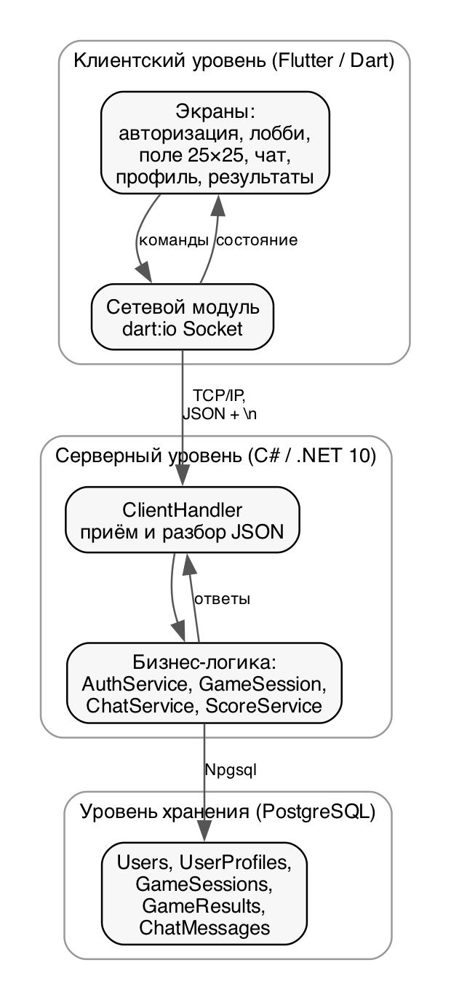

# Описание программы

Министерство науки и высшего образования Российской Федерации

Автономная некоммерческая организация профессиональная

образовательная организация Московский международный колледж

цифровых технологий «Академия ТОП»

Факультет Информационных систем и программирования

Кафедра Разработка программного обеспечения

| СОГЛАСОВАНО Руководитель проекта от кафедры, преподаватель _________ /Д. В. Золотухин / «___» ____________ 2026 г. | УТВЕРЖДАЮ Заведующий выпускающей кафедрой ________ / И. О. Фамилия / «___» ___________ 2026 г. |
| --- | --- |

# ОПИСАНИЕ ПРОГРАММЫ

# Программный комплекс «Крестики и нолики»

| Листов: 12 | Исполнители (разработчики): Студенты группы 9/3 – РПО 24/2 __________ / К. Д. Бызов/ «11» ноября 2026 г. |
| --- | --- |

МОСКВА — 2026 г.

# 1. Общие сведения

## 1.1. Наименование программы

Наименование программы: программный комплекс «Крестики и нолики». Обозначение: ПК-КН.01. Версия 1.0. Документ оформлен в соответствии с требованиями ГОСТ 19.402-78 «Описание программы».

## 1.2. Необходимое программное обеспечение

Программный комплекс состоит из серверной части на языке C# с использованием платформы .NET 10, клиентской части на Flutter (Dart) и базы данных PostgreSQL. Сервер и база данных запускаются в Docker-контейнерах; клиент работает как release-сборка Windows или веб-сборка.

## 1.3. Языки программирования

Серверная часть реализована на C# (.NET 10), клиентская — на Dart (Flutter). Запросы к базе данных написаны на SQL и выполняются через провайдер Npgsql. Обмен между клиентом и сервером — JSON поверх TCP/IP.

## 1.4. Сведения о разработчике и об эксплуатации

Разработчик: Бызов К. Д., студент группы 9/3 – РПО 24/2. Дата выпуска документа: 11 ноября 2026 г. Программа эксплуатируется в локальной сети учебного класса или небольшой организации; серверная часть размещается на компьютере с Docker, клиенты — на рабочих станциях Windows 10/11.

# 2. Функциональное назначение

## 2.1. Назначение программы

Программа предназначена для организации сетевой игры «Крестики и нолики» между двумя пользователями на поле 25 × 25 с условием победы «пять в ряд». Дополнительно реализуются авторизация, профиль игрока, создание игровых сессий и подключение по идентификатору, чат с фильтрацией нецензурных слов, автоматический подсчёт баллов и итоговый счёт.

## 2.2. Классы решаемых задач

Программа решает следующие задачи:

– авторизация пользователей и защита учётных записей;

– создание и редактирование профиля игрока;

– создание игровой сессии и подключение второго игрока по идентификатору;

– отображение поля 25 × 25 и выполнение ходов;

– проверка допустимости хода: очередь, диапазон 0–24, свободная клетка;

– определение победы по пяти символам в ряд и ничьей;

– синхронизация состояния поля между клиентами в режиме реального времени;

– чат двух игроков с серверной фильтрацией нецензурной лексики;

– автоматический подсчёт баллов (3 за победу, 1 за ничью, 0 за поражение);

– хранение профилей, результатов и истории сообщений в PostgreSQL.

## 2.3. Функциональные ограничения

В одной сессии участвуют не более двух игроков. Мини-игра выбора первого хода, список друзей и социальные функции в текущую версию не входят. Соединение не защищено TLS и рассчитано на доверенную локальную сеть. Автоматическое переподключение к начатой партии и восстановление сессий после аварийного завершения сервера не поддерживаются.

## 2.4. Условия применения

Область применения — учебные и локальные сети, персональные компьютеры под управлением Windows 10/11. Сервер работает в Linux-контейнере Docker; на Windows используется Docker Desktop с Linux-контейнерами. Для работы через Интернет требуется дополнительная настройка межсетевого экрана и защита соединения, что не входит в текущий объём.

# 3. Описание логической структуры

## 3.1. Общий алгоритм функционирования

Программа построена по клиент-серверной архитектуре. Сервер является единственным источником истины: он хранит состояние поля, проверяет ходы и определяет результат. Клиент отправляет команды и отображает подтверждённое сервером состояние.

Порядок взаимодействия:

1. Клиент устанавливает TCP-соединение с сервером.

2. Отправляет сообщение auth и получает профиль.

3. Создаёт сессию или подключается к существующей по sessionId.

4. После подключения второго игрока сервер инициализирует поле 25 × 25.

5. Клиенты по очереди отправляют move; сервер проверяет ход.

6. После каждого хода сервер рассылает state обоим участникам.

7. При завершении партии отправляется result и обновляется статистика.

8. Клиенты отображают итог и возвращаются в лобби.

## 3.2. Используемые методы

Обмен выполняется по протоколу TCP/IP сообщениями JSON, разделёнными символом конца строки. На сервере применяются асинхронные методы System.Net.Sockets и async/await; обработка команд одной сессии сериализуется через CommandLock. Проверка победы выполняется только вокруг последнего хода по четырём направлениям. Фильтрация чата выполняется на сервере с учётом регистра, похожих символов и разделителей.

## 3.3. Структура программы

Логическая структура включает три уровня: представления (Flutter), бизнес-логики (C# / .NET 10) и хранения данных (PostgreSQL).

Схема приведена на рисунке 1.

Рисунок 1 — Архитектура программного комплекса

## 3.4. Функции составных частей

Состав основных модулей приведён в таблице 1.

Таблица 1 — Состав модулей программного комплекса

| Модуль | Технология | Назначение |
| --- | --- | --- |
| Client UI | Flutter / Dart | Экраны авторизации, лобби, игрового поля 25 × 25, чата, профиля и результатов; обработка ввода пользователя. |
| SocketClient | Flutter / Dart | Установка TCP-соединения, отправка JSON-команд, приём и разбор состояния, буферизация по символу «\n». |
| ClientHandler | C# / .NET 10 | Приём подключения, чтение JSON, определение типа команды, вызов бизнес-логики и отправка ответа. |
| AuthService | C# / .NET 10 | Проверка логина и пароля, хеширование, привязка соединения к пользователю. |
| GameSession | C# / .NET 10 | Управление партией: участники, очередь, статус, обработка хода, проверка победы и ничьей. |
| GameBoard | C# / .NET 10 | Хранение поля 25 × 25, проверка свободной клетки, установка символа, проверка заполненности. |
| ChatService | C# / .NET 10 | Фильтрация текста: приведение к нижнему регистру, замена похожих символов и замена запрещённых выражений на «***». |
| ScoreService | C# / .NET 10 | Расчёт баллов: 3 за победу, 1 за ничью, 0 за поражение. |
| DbRepository | Npgsql / PostgreSQL | Параметризованные запросы, транзакции, обновление статистики, чтение и запись профилей, сессий, результатов и сообщений. |

## 3.5. Связи между компонентами

Основные типы сообщений приведены в таблице 2.

Таблица 2 — Основные типы сообщений

| Тип | Направление | Основные поля | Назначение |
| --- | --- | --- | --- |
| auth | клиент → сервер | login, password | Авторизация |
| auth_ok | сервер → клиент | userId, login, nickname, profile | Подтверждение входа |
| profile_get | клиент → сервер | — | Запрос профиля текущего пользователя |
| profile_update | клиент → сервер | nickname | Изменение профиля |
| profile | сервер → клиент | nickname, gamesPlayed, wins, losses, totalScore | Профиль игрока |
| session_create | клиент → сервер | — | Создание игровой сессии |
| session_created | сервер → клиент | sessionId, symbol, status | Сессия создана |
| session_join | клиент → сервер | sessionId | Подключение к сессии |
| session_started | сервер → клиент | sessionId, symbol, board, turn, players | Партия началась |
| move | клиент → сервер | sessionId, row, column | Выполнение хода |
| state | сервер → клиент | sessionId, board, turn, status, winner | Состояние поля |
| chat | клиент ↔ сервер | sessionId, senderId, sender, text, at | Сообщение чата |
| result | сервер → клиент | sessionId, winner, winnerId, scoreX, scoreO, draw | Итог партии |
| leave | клиент → сервер | — | Выход из сессии |
| opponent_left | сервер → клиент | message | Соперник вышел |
| left | сервер → клиент | — | Выход подтверждён |
| ping / pong | клиент ↔ сервер | — | Проверка соединения |
| error | сервер → клиент | code, message | Описание ошибки |

## 3.6. Связи с другими программами

Сервер использует PostgreSQL через Npgsql и не имеет прямого доступа к клиентским файлам. Docker Compose связывает контейнеры server и db в отдельную сеть; наружу публикуется только порт 5000. Клиент не требует установленного Flutter SDK в release-сборке. Взаимодействие с ОС ограничивается сетевыми сокетами, файлами журналов и томом pgdata.

## 3.7. Обработка ошибок

Основные сообщения об ошибках приведены в таблице 3. При ошибке состояние поля не изменяется, клиент получает код и текстовое описание.

Таблица 3 — Сообщения об ошибках

| Код | Сообщение | Действие пользователя |
| --- | --- | --- |
| AUTH-00 | Сначала авторизуйтесь | Выполнить вход |
| AUTH-01 | Неверный логин или пароль | Проверить данные и повторить вход |
| AUTH-02 | Заполните логин и пароль | Заполнить оба поля |
| AUTH-03 | Пользователь уже в сети | Завершить другой сеанс |
| AUTH-04 | Вы уже авторизованы | Продолжить работу |
| AUTH-05 | Слишком много попыток | Подождать и повторить вход |
| SES-00 | Не удалось создать/подключить сессию | Повторить попытку |
| SES-01 | Сессия не найдена | Проверить идентификатор сессии |
| SES-02 | Сессия заполнена | Создать новую сессию |
| SES-03 | Нельзя подключиться к своей сессии | Создать новую сессию |
| SES-04 | Вы уже в игровой сессии | Выйти из текущей сессии |
| GAME-00 | Ошибка хода | Повторить ход |
| GAME-01 | Сейчас ход другого игрока | Дождаться своей очереди |
| GAME-02 | Клетка уже занята | Выбрать свободную клетку |
| GAME-03 | Координаты вне диапазона | Выбрать клетку от 0 до 24 |
| GAME-04 | Партия не найдена или не активна | Начать новую партию |
| GAME-05 | Вы не участник сессии | Войти в свою сессию |
| CHAT-01 | Пустое сообщение | Ввести текст |
| CHAT-02 | Сообщение слишком длинное | Сократить текст до 500 символов |
| CHAT-03 | Вы не находитесь в игровой сессии | Войти в сессию |
| PROFILE-01 | Никнейм должен быть от 1 до 64 символов | Исправить никнейм |
| PROTO-01 | Некорректный JSON | Проверить формат сообщения |
| PROTO-02 | Слишком длинное сообщение | Сократить пакет |

# 4. Используемые технические средства

Серверный компьютер: процессор с частотой не менее 2 ГГц, оперативная память не менее 4 ГБ, свободное место на диске не менее 3 ГБ для образов Docker, базы данных и резервных копий, сетевой адаптер. Клиентские компьютеры: Windows 10/11, процессор 1,5 ГГц, ОЗУ 2 ГБ, свободное место 50 МБ, сетевой адаптер. Сеть: TCP/IP, локальная сеть с пропускной способностью не менее 100 Мбит/с.

Программное обеспечение: Docker Engine 24+ и Docker Compose v2; контейнер server с .NET 10 Runtime; контейнер db с PostgreSQL 15+; клиентское приложение Flutter (сборка для Windows).

# 5. Вызов и загрузка

## 5.1. Способ вызова программы

Запуск серверной части и PostgreSQL в Docker:

docker compose up -d --build

Запуск клиентской части:

ttt_client.exe

## 5.2. Входные точки в программу

Серверная входная точка — метод Main в Program.cs: он читает конфигурацию, инициализирует базу данных и запускает TcpListener на порту 5000. Клиентская входная точка — функция main() в main.dart, создающая MaterialApp и экран авторизации.

## 5.3. Порядок загрузки и завершения работы

Docker Compose поднимает контейнеры server и db. Схема базы данных создаётся автоматически при первом запуске, тестовые учётные записи — если их ещё нет. Клиент запрашивает адрес сервера и порт (по умолчанию localhost:5000), после чего открывает экран авторизации. Остановка контейнера server завершает активные сессии; результаты незавершённых партий не сохраняются.

## 5.4. Резервное копирование

Резервная копия базы данных создаётся командой:

docker compose exec -T db pg_dump -U ttt -d ttt -F c > backup.dump

Восстановление выполняется командой pg_restore. Копии хранятся вне тома pgdata; перед обновлением версии создаётся дополнительная копия.

# 6. Входные данные

## 6.1. Характер и организация входных данных

Входные данные поступают от пользователя через клиентский интерфейс и передаются на сервер JSON-сообщениями. К ним относятся учётные данные, команды управления сессией, координаты клетки и текст сообщения чата.

## 6.2. Предварительная подготовка

До начала работы администратор запускает Docker Compose, проверяет healthcheck контейнеров и при необходимости создаёт учётные записи. Пользователь получает логин и пароль, запускает клиент и указывает адрес сервера и порт.

## 6.3. Форматы и описание входных данных

Входные данные программы приведены в таблице 4.

Таблица 4 — Входные данные

| Данные | Описание |
| --- | --- |
| Логин и пароль | Учётные данные для авторизации |
| Данные профиля | Никнейм и изменяемые сведения профиля |
| Идентификатор сессии | Номер игровой комнаты для подключения |
| Координаты клетки | Row и Column в диапазоне 0–24 |
| Текст сообщения | Сообщение чата длиной до 500 символов |
| Команды управления | Создать сессию, подключиться, выйти из игры |

Пример запроса хода:

{"type":"move","sessionId":17,"row":12,"column":5}

# 7. Выходные данные

## 7.1. Характер и организация выходных данных

Выходные данные формируются сервером и передаются клиентам в виде JSON-сообщений: состояние поля, очередь хода, результат, сообщения чата и коды ошибок. Клиент не изменяет состояние самостоятельно.

## 7.2. Форматы и описание выходных данных

Выходные данные программы приведены в таблице 5.

Таблица 5 — Выходные данные

| Данные | Описание |
| --- | --- |
| Состояние поля | Матрица 25 × 25 с символами X, O и пустыми клетками |
| Очередь хода | 1 — X, 2 — O |
| Статус партии | waiting, active, finished, cancelled |
| Результат | winner, winnerId, draw |
| Баллы партии | scoreX и scoreO |
| Статистика профиля | gamesPlayed, wins, losses, totalScore |
| Сообщения чата | Отфильтрованный текст сообщений |
| Сообщения об ошибках | Код и описание ошибки |

Пример подтверждённого состояния:

{"type":"state","sessionId":17,"turn":2,
 "status":"active","winner":null}

Поле board в примере опущено: это массив из 25 строк по 25 целых чисел (0 — свободно, 1 — X, 2 — O). При обрыве соединения клиент показывает сообщение локально и возвращается на экран авторизации; автоматическое переподключение к начатой партии не выполняется.
