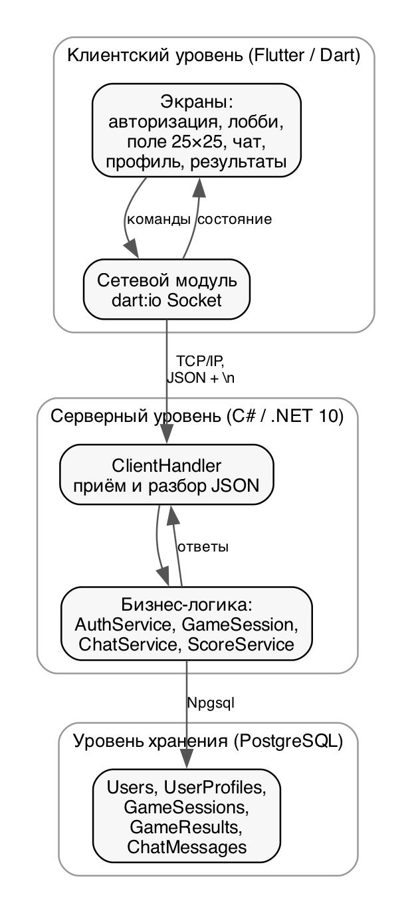
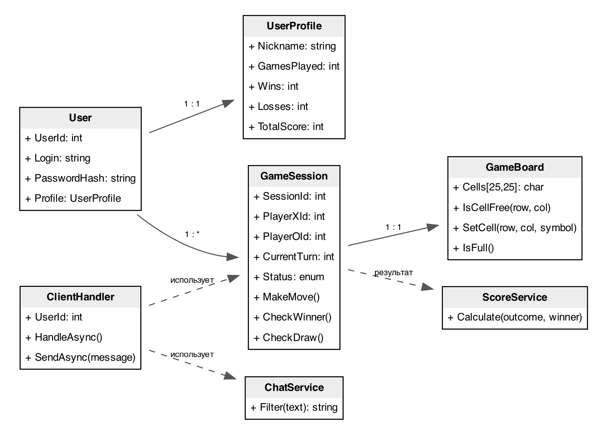
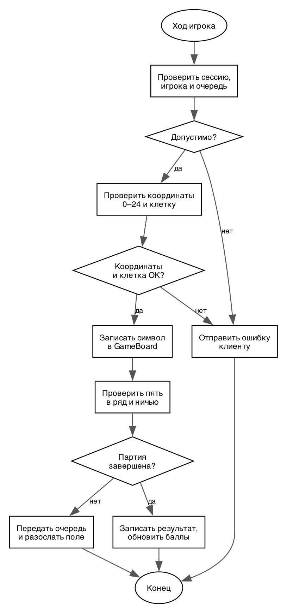
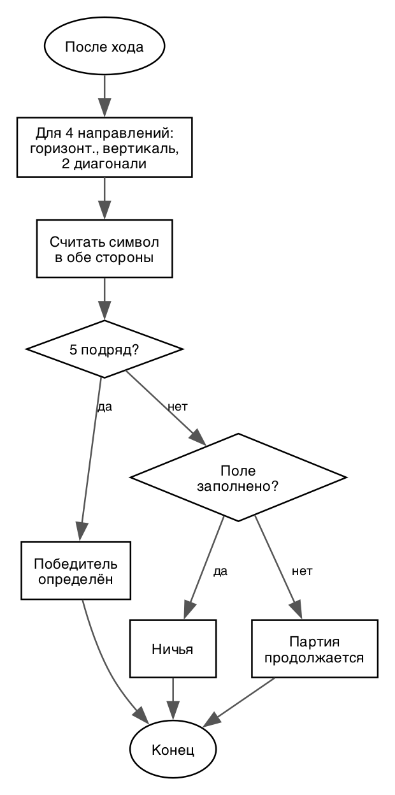
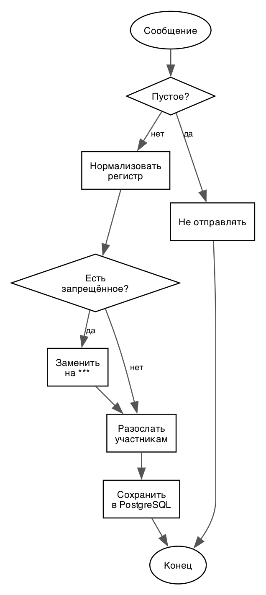

# Пояснительная записка

## 1. Введение

Многопользовательские сетевые приложения реального времени являются одним из наиболее показательных классов задач в дисциплине «Технология разработки программного обеспечения». Они требуют одновременного решения вопросов проектирования протокола обмена данными, синхронизации состояния между несколькими независимыми клиентами и обеспечения устойчивости системы к сбоям сети. Классическая игра «Крестики и нолики» удобна как учебный полигон: её правила просты, но сетевая реализация порождает полный набор инженерных задач — единый источник истины для игрового поля, защиту от состояния гонки при одновременных действиях, корректную обработку разрыва соединения и фильтрацию пользовательского контента.

В проекте реализуется расширенная версия игры для одиночной разработки: поле размером 25 × 25, победа присуждается игроку, собравшему пять своих символов подряд по горизонтали, вертикали или диагонали. Увеличение поля и ужесточение условия победы повышают требования к алгоритму проверки комбинаций и к передаче состояния: клиент не должен получать и обрабатывать весь массив поля без необходимости, а сервер обязан проверять каждый ход и рассылать только подтверждённое состояние.

Цель проекта — разработка клиент-серверного программного комплекса, реализующего игру «Крестики и нолики» между двумя удалёнными пользователями, с сопутствующим функционалом: авторизацией, профилем пользователя, созданием игровых сессий и подключением по идентификатору, текстовым чатом с фильтрацией нецензурной лексики, автоматическим подсчётом баллов и формированием итогового счёта.

При предпроектном анализе были рассмотрены аналогичные решения. Промышленные сетевые фреймворки (Photon Engine, Mirror Networking) обладают развитыми механизмами компенсации задержек и масштабирования, однако избыточны для двухпользовательской игры и требуют зависимости от сторонней инфраструктуры. Браузерные реализации «Крестиков-ноликов» на WebSocket доступны без установки клиента, но, как правило, лишены полноценных профилей, сохранения результатов и серверной фильтрации сообщений. Разрабатываемая система занимает промежуточную нишу: она не перегружена абстракциями промышленных движков, но реализует расширенный прикладной функционал.

Целевой объём разработки — клиент-серверное приложение объёмом не менее 1000 операторов на языке C#, с графическим клиентом на Flutter и собственным прикладным протоколом поверх TCP/IP. Хранение учётных записей, профилей, результатов партий и истории сообщений выполняется в PostgreSQL.

Пояснительная записка содержит анализ задания и обоснование выбора технологий, описание логической и физической архитектуры, структур данных и классов, алгоритмов авторизации, обработки хода, проверки победы, фильтрации сообщений, создания сессии и подсчёта баллов, а также подготовку тестовых данных для последующей проверки работоспособности.

Работа состоит из пяти разделов. В первом обоснованы актуальность, цель и границы проекта. Во втором разобраны требования задания и выбран стек технологий. Третий раздел описывает архитектуру, структуры данных и алгоритмы. Четвёртый содержит тестовые данные и стратегию проверки. Пятый подводит итоги и фиксирует ограничения версии 1.0.

Для достижения цели решаются задачи: анализ предметной области и существующих решений; выбор серверной и клиентской платформ; проектирование прикладного протокола и структур хранения; реализация авторизации, игровых сессий, ходов, чата и подсчёта баллов; подготовка тестовых данных и проверка основных сценариев.

Результатом работы является программный комплекс, который можно запустить в локальной сети, провести партию двух игроков и сохранить результат в PostgreSQL. Все решения ограничены учебным проектом и не претендуют на промышленную масштабируемость.

## 2. Анализ задания и выбор технологии разработки

### 2.1. Обоснование выбора технологий

Серверная часть разрабатывается на языке C# с использованием платформы .NET 10. Выбор обоснован наличием зрелой библиотеки System.Net.Sockets для низкоуровневой работы с TCP-соединениями, встроенной поддержкой асинхронного программирования (async/await, Task), что критично для одновременной обработки нескольких клиентских соединений без блокировки основного потока, а также строгой типизацией, снижающей количество ошибок при разборе сетевых пакетов.

Для взаимодействия с базой данных используется библиотека Npgsql — официальный .NET-провайдер для PostgreSQL. Она обеспечивает поддержку параметризованных запросов (защита от SQL-инъекций) и асинхронных операций чтения/записи, что согласуется с асинхронной моделью сервера.

Клиентская часть разрабатывается на Flutter (Dart). Задание допускает клиент на Web, WPF или Flutter; выбран Flutter, поскольку он позволяет построить единую кодовую базу интерфейса, обеспечивает декларативное построение виджет-дерева и содержит встроенный класс Socket (dart:io) для работы с TCP-соединением без сторонних сетевых библиотек. Реактивность интерфейса обеспечивается нативными средствами Flutter SDK — классом StatefulWidget и методом setState(). При получении JSON-пакета клиент десериализует его во внутреннюю модель, после чего вызывает setState(), инициирующий перестроение затронутой части дерева виджетов. Для проекта данного масштаба (авторизация, лобби, игровое поле, чат, профиль, результаты) этого достаточно; внешний state-менеджер увеличил бы объём кода без ощутимого выигрыша.

При выборе клиентской платформы рассматривались Web, WPF и Flutter. Web-клиент не требует установки и удобен для быстрого доступа, но браузер не предоставляет сырой TCP-сокет, поэтому потребовался бы дополнительный WebSocket-мост и ещё один сетевой компонент. WPF даёт нативный интерфейс Windows и прямой доступ к сокетам, однако привязывает проект к одной операционной системе и увеличивает объём кода, связанного с интерфейсом. Flutter обеспечивает единую кодовую базу, декларативный интерфейс и встроенный класс dart:io Socket; один и тот же код может быть собран под Windows и другие платформы. Для учебного проекта, где важны наглядность, минимум внешних зависимостей и возможность показать клиент на разных машинах, выбран Flutter.

Прикладной протокол построен по принципу «одно сообщение — одна строка». Клиент и сервер обмениваются JSON-объектами с обязательным полем type; остальные поля зависят от команды. Для авторизации передаются login и password, для хода — sessionId, row и column, для чата — sessionId и text. Сервер отвечает сообщениями auth_ok, state, result, chat или error. Разделение по символу перевода строки позволяет использовать обычный StreamReader/StreamWriter на сервере и потоковое чтение сокета на клиенте без отдельного бинарного парсера.

Формат обмена данными — JSON. На серверной стороне используется встроенный в .NET модуль System.Text.Json, на клиентской — встроенный в Dart модуль dart:convert. Поэтому не нужно писать собственный бинарный протокола сериализации и упрощает отладку сетевого трафика.

Хранение данных реализовано на базе PostgreSQL. Обоснование: надёжная транзакционность (свойства ACID), полноценная поддержка внешних ключей, высокая производительность при выборках профилей и истории матчей с операциями JOIN. Транзакционность критична при одновременной записи результата матча и обновлении статистики побед/поражений обоих игроков — эти операции должны выполняться атомарно.

Транспортный протокол — TCP/IP. В отличие от UDP, TCP гарантирует надёжную доставку и сохранение очерёдности байт без необходимости реализации собственного прикладного механизма подтверждений, что критично для авторизации, передачи ходов и сообщений чата. Поскольку TCP является потоковым протоколом и не сохраняет границы сообщений, в прикладном протоколе используется разделение по символу конца строки: каждое JSON-сообщение оканчивается символом «\n», а приёмник буферизует данные до его обнаружения.

Отдельно проработаны вопросы безопасности. Пароли хранятся не в открытом виде, а в виде хеша с солью; для проверки используется стойкая функция хеширования. Все запросы к PostgreSQL выполняются через параметризованные команды Npgsql, что исключает SQL-инъекции. Сервер повторно проверяет типы и диапазоны всех полей JSON-сообщения, а также принадлежность пользователя к сессии; данные клиента не считаются доверенными.

Ограничивается размер принимаемого сообщения и длина текста чата, что защищает сервер от переполнения буфера и неконтролируемого роста базы. Ошибки разбора JSON не приводят к аварийному завершению: клиент получает код ошибки, соединение остаётся доступным для следующих команд.

Главное архитектурное решение: сервер — единственный источник истины. Клиент не определяет победителя, допустимость хода или результат партии; он отправляет команду и отображает подтверждённое сервером состояние. Так клиентский код не может изменить игру, а поле остаётся согласованным у обоих участников.

### 2.2. Логическая и физическая архитектура

Программный комплекс «Крестики и нолики» строится на основе клиент-серверной архитектуры, предусматривающей разделение ответственности между серверной частью, клиентским приложением и системой хранения данных. Логическая архитектура разделена на три уровня: представления, серверной бизнес-логики и хранения данных. Основные компоненты приведены в таблице 1.

Таблица 1 — Архитектурные компоненты программного комплекса

| Компонент | Технология | Зона ответственности |
| --- | --- | --- |
| Presentation Layer (клиент) | Flutter / Dart | Отображение экранов авторизации, лобби, поля 25 × 25, чата, профиля и результатов; обработка ввода; отправка команд и приём состояния. |
| Business Logic Layer (сервер) | C# / .NET 10 | Авторизация, управление сессиями, подключение по идентификатору, валидация ходов, проверка пяти в ряд и ничьей, фильтрация сообщений, подсчёт баллов. |
| Data Access Layer | Npgsql / PostgreSQL | Хранение учётных записей, профилей, сессий, результатов и сообщений; параметризованные запросы и транзакции. |

Схема приведена на рисунке 1.



Рисунок 1 — Логическая архитектура программного комплекса

Физическая архитектура предусматривает размещение серверного приложения и СУБД PostgreSQL на компьютере, доступном клиентам по локальной сети. Клиентские приложения устанавливаются на персональных компьютерах под управлением Windows 10/11. Сервер поддерживает несколько одновременных подключений и несколько независимых игровых сессий, каждая из которых содержит собственное состояние поля, сведения об участниках и информацию об очерёдности ходов.

Взаимодействие выполняется по протоколу TCP/IP. Клиент устанавливает соединение, проходит авторизацию, затем создаёт игровую сессию или подключается к существующей по идентификатору. После подключения второго игрока сервер инициализирует поле 25 × 25, назначает символы X и O и передаёт право первого хода. Каждый ход сопровождается подтверждением и рассылкой обновлённого состояния обоим участникам. Критерием режима реального времени принято время от отправки хода до отображения у второго клиента не более 1 с.

Сценарий одной партии:

1. Клиент подключается к серверу и проходит авторизацию.

2. Игрок создаёт сессию; сервер присваивает идентификатор и ждёт соперника.

3. Второй игрок подключается по идентификатору; сервер назначает X и O.

4. Сервер инициализирует поле 25 × 25 и передаёт право первого хода.

5. Игроки по очереди отправляют координаты клеток.

6. Сервер проверяет ход, обновляет поле и рассылает состояние обоим.

7. После каждого хода проверяется пять в ряд и заполненность поля.

8. При победе, ничьей или выходе игрока партия завершается.

9. Результат и баллы записываются в PostgreSQL в одной транзакции.

10. Клиенты отображают итог и возвращаются в лобби.

Завершение одной игровой сессии не должно приводить к остановке серверного приложения или нарушению работы других сессий. При выходе одного из игроков продолжение партии блокируется, соперник получает информационное сообщение, а результат фиксируется в базе данных.

При развёртывании серверное приложение и PostgreSQL размещаются на одном узле; сервер слушает TCP-порт 5000, а база доступна только внутри локальной сети или Docker-сети. Клиенты подключаются к серверу по IP-адресу и порту, не имея прямого доступа к базе. Такая схема упрощает администрирование и снижает поверхность атаки: наружу опубликован только игровой порт.

Последовательность одной партии: клиент устанавливает соединение, проходит авторизацию, создаёт сессию или подключается по идентификатору; сервер инициализирует поле 25 × 25, назначает символы X и O и передаёт право первого хода. Далее игроки по очереди отправляют координаты, сервер валидирует ход, обновляет поле и рассылает состояние обоим участникам. После победы или ничьей результат и статистика записываются в PostgreSQL, а клиенты получают итоговое сообщение. При выходе игрока или потере связи сессия отменяется, баллы не начисляются.

### 2.3. Структуры данных и описание классов

Для реализации функциональных возможностей используется объектно-ориентированная структура серверного приложения и реляционная база данных PostgreSQL. Основными объектами предметной области являются пользователь, профиль, игровая сессия, игровое поле, сообщение чата и результат партии.

Основные таблицы базы данных:

– Users (Пользователи): UserId (PK), Login, PasswordHash, IsBlocked, RegistrationDate. Хранит учётные записи и данные для авторизации.

– UserProfiles (Профили): ProfileId (PK), UserId (FK), Nickname, GamesPlayed, Wins, Losses, TotalScore. Содержит игровую статистику и итоговый счёт.

– GameSessions (Игровые сессии): SessionId (PK), PlayerXId (FK), PlayerOId (FK), BoardState, CurrentTurn, Status, CreatedAt, FinishedAt. Хранит состояние активной или завершённой партии.

– GameResults (Результаты): ResultId (PK), SessionId (FK), WinnerId (FK), ResultType, FinishedAt. Фиксирует итог завершённой партии.

– ChatMessages (Сообщения): MessageId (PK), SessionId (FK), SenderId (FK), MessageText, SentAt. Содержит историю сообщений игровой сессии.

Основные поля таблиц:

– Users: UserId (PK, int), Login (varchar, unique), PasswordHash (text), IsBlocked (boolean), RegistrationDate (timestamp).

– UserProfiles: ProfileId (PK), UserId (FK, unique), Nickname (varchar), GamesPlayed (int), Wins (int), Losses (int), TotalScore (int).

– GameSessions: SessionId (PK), PlayerXId (FK), PlayerOId (FK), BoardState (text), CurrentTurn (int), Status (varchar), CreatedAt, FinishedAt.

– GameResults: ResultId (PK), SessionId (FK), WinnerId (FK, null при ничьей), ResultType (varchar), FinishedAt.

– ChatMessages: MessageId (PK), SessionId (FK), SenderId (FK), MessageText (text), SentAt (timestamp).

Поле BoardState может храниться в виде строки или JSON-массива из 625 элементов; для активных сессий оно дополнительно кэшируется в памяти сервера. Первичные и внешние ключи обеспечивают целостность данных и предотвращают появление записей, не связанных с существующими пользователями или сессиями.

На уровне серверного приложения выделяются следующие классы.

– User — зарегистрированный пользователь: идентификатор, логин, хеш пароля, профиль. Методы получения и изменения профиля.

– UserProfile — игровая статистика: никнейм, количество партий, побед, поражений, итоговый счёт.

– GameSession — управление партией: идентификаторы игроков, текущая очередь, статус, поле. Методы MakeMove(), CheckWinner(), CheckDraw(), EndGame().

– GameBoard — игровое поле 25 × 25: двумерный массив символов, проверка свободной клетки, установка символа, проверка заполненности.

– ClientHandler — обработка отдельного TCP-соединения: чтение JSON, определение типа команды, вызов бизнес-логики и отправка ответа.

– ChatService — фильтрация текста: приведение к нижнему регистру, замена похожих символов, поиск запрещённых выражений и замена их на «***».

– ScoreService — расчёт баллов (3 за победу, 1 за ничью, 0 за поражение). Обновление статистики выполняет DbRepository в транзакции FinishGameAsync().

Класс GameSession инкапсулирует состояние одной партии: идентификаторы игроков, текущую очередь, поле и статус. Метод MakeMove проверяет сессию, участника, очередь, диапазон координат и свободность клетки, после чего записывает символ и вызывает CheckWinner и CheckDraw. Метод EndGame переводит сессию в завершённое состояние. GameBoard отвечает только за хранение матрицы 25 × 25 и операции с клетками, не зная о сети и базах данных.

ClientHandler обслуживает одно TCP-соединение: читает строки, разбирает JSON, вызывает бизнес-логику и отправляет ответ. ChatService только фильтрует текст, рассылку выполняет GameServer.BroadcastAsync(), сохранение истории — DbRepository.SaveChatMessageAsync(). ScoreService рассчитывает баллы, а транзакционное обновление профилей и запись результата выполняет DbRepository.FinishGameAsync(). Разделение ответственности позволяет тестировать игровую логику отдельно от сетевого транспорта и интерфейса.

Схема приведена на рисунке 2.



Рисунок 2 — Диаграмма классов серверного приложения

Для ускорения выборок создаются индексы по внешним ключам (UserId, SessionId), по логину пользователя и по дате завершения партии FinishedAt. Ограничения UNIQUE не позволяют зарегистрировать два одинаковых логина, два профиля для одного пользователя или два результата для одной сессии. Удаление пользователя через клиентский интерфейс не предусмотрено; внешние ключи защищают историю партий и сообщений от нарушения целостности.

Взаимодействие классов организовано так, чтобы игровая логика не зависела от графического интерфейса. Благодаря этому можно независимо тестировать серверные алгоритмы и изменять визуальное представление клиента без переработки основных игровых механизмов.

### 2.4. Требования к надёжности и безопасности

Надёжность обеспечивается серверной валидацией всех действий, запретом хода в занятую клетку, проверкой очереди и диапазона координат, а также изоляцией игровых сессий. Ошибка одного клиента не должна влиять на другие сессии: сервер обрабатывает каждое соединение независимо и завершает только ту сессию, в которой произошёл сбой.

Безопасность обеспечивается хешированием паролей с солью, параметризованными запросами Npgsql, повторной проверкой типов и диапазонов полей JSON, ограничением длины сообщений и запретом клиентских решений о результате партии. Соединение не использует TLS, поэтому эксплуатация предполагается в доверенной локальной сети.

К надёжности относится и корректное завершение: при выходе игрока или потере связи сервер уведомляет соперника, блокирует продолжение и фиксирует отмену сессии. Такой порядок исключает «зависание» партии и неопределённое состояние поля.

## 3. Описание алгоритмов и структур данных

В разделе рассматриваются основные алгоритмы, обеспечивающие взаимодействие пользователей с сервером, управление сессиями и соблюдение правил игры. Особое внимание уделяется алгоритмам, от корректности которых зависит согласованность игрового состояния: авторизации, обработки хода, проверки победы, фильтрации сообщений и подсчёта баллов.

### 3.1. Алгоритм авторизации пользователей

Назначение: проверка учётных данных и предоставление доступа к функциям программы. Авторизация необходима для идентификации участников сессий, сохранения результатов и защиты профилей.

Входные данные: логин и пароль. Выходные данные: результат проверки, идентификатор пользователя и данные профиля.

Пошаговое описание:

Шаг 1. Пользователь запускает клиент и открывает экран авторизации.

Шаг 2. Вводит логин и пароль; клиент проверяет, что поля не пусты.

Шаг 3. Клиент формирует JSON-запрос авторизации и отправляет его по TCP-соединению.

Шаг 4. Сервер определяет тип операции и извлекает учётные данные.

Шаг 5. Проверяется блокировка логина после пяти неудачных попыток за последнюю минуту.

Шаг 6. Сервер ищет пользователя в PostgreSQL по логину с помощью параметризованного запроса Npgsql.

Шаг 7. Если пользователь не найден или заблокирован, формируется отказ.

Шаг 8. Если учётная запись существует, введённый пароль сравнивается с сохранённым хешем с солью; при несовпадении фиксируется неудачная попытка.

Шаг 9. При несовпадении клиент получает сообщение «Неверный логин или пароль».

Шаг 10. При успехе сервер связывает текущее соединение с идентификатором пользователя, сбрасывает счётчик неудач и загружает профиль.

Шаг 11. Клиент получает подтверждение и открывает лобби.

Алгоритм обеспечивает централизованную проверку права доступа. Пароль не передаётся повторно в открытом виде после авторизации; все последующие команды привязываются к соединению и идентификатору пользователя.

### 3.2. Алгоритм обработки хода и синхронизации

Назначение: корректное применение хода к полю 25 × 25 и синхронизация состояния между двумя клиентами. Алгоритм предотвращает конфликты при одновременных командах и гарантирует, что клиенты не могут изменить поле самостоятельно.

Входные данные: SessionId, UserId, Row, Column (0–24). Выходные данные: обновлённое состояние поля, информация об очереди и статусе партии.

Пошаговое описание:

Шаг 1. Клиент отправляет координаты выбранной клетки.

Шаг 2. Сервер определяет сессию по SessionId.

Шаг 3. Проверяется, что партия не завершена и соединение активно.

Шаг 4. Проверяется, что пользователь входит в число участников сессии.

Шаг 5. Проверяется очерёдность: UserId должен совпадать с текущим игроком.

Шаг 6. Проверяется диапазон координат: Row и Column от 0 до 24.

Шаг 7. Проверяется, что клетка свободна.

Шаг 8. В GameBoard записывается символ текущего игрока.

Шаг 9. Запускается проверка пяти в ряд и ничьей.

Шаг 10. Если партия завершена, фиксируется результат и обновляются баллы.

Шаг 11. Иначе очередь передаётся сопернику.

Шаг 12. Сервер рассылает обновлённое состояние обоим участникам.

Шаг 13. Клиенты обновляют поле через setState().

Основные ошибки, возвращаемые сервером: «Сессия не найдена», «Вы не участник сессии», «Сейчас ход другого игрока», «Клетка уже занята», «Координаты вне диапазона», «Партия не найдена или не активна». Каждая ошибка содержит код и текстовое описание; состояние поля при этом не изменяется.

Пример запроса хода:

```
{&quot;type&quot;:&quot;move&quot;,&quot;sessionId&quot;:17,&quot;row&quot;:12,&quot;column&quot;:5}
```

Пример подтверждённого ответа сервера:

```
{&quot;type&quot;:&quot;state&quot;,&quot;sessionId&quot;:17,&quot;turn&quot;:2,
 &quot;status&quot;:&quot;active&quot;,&quot;winner&quot;:null}
```

Поле board в примере опущено: это массив из 25 строк по 25 целых чисел (0 — свободно, 1 — X, 2 — O).

Обработка команд в пределах одной сессии выполняется последовательно, что исключает одновременное применение двух ходов к одному состоянию. Любая ошибка возвращает клиенту код и описание, не изменяя поле.

Для предотвращения состояния гонки вся команда сессии — проверка, изменение поля, сохранение в БД и рассылка — выполняется под очередью CommandLock. Такой порядок исключает одновременное применение двух ходов к одному массиву и гарантирует, что оба клиента получают одинаковый снимок поля. Рассылка выполняется после фиксации изменения, поэтому клиент не может увидеть промежуточное состояние.

Схема приведена на рисунке 3.



Рисунок 3 — Алгоритм обработки хода и синхронизации

### 3.3. Алгоритм проверки победы и ничьей

Назначение: после каждого хода определить, собрал ли игрок пять символов подряд, и не заполнено ли поле полностью. Проверка выполняется только вокруг последнего хода, что даёт постоянное время O(1) на ход и не требует полного перебора 625 клеток.

Для клетки (row, column) проверяются четыре направления: горизонталь, вертикаль, главная диагональ и побочная диагональ. В каждом направлении считается количество одинаковых символов в обе стороны от последнего хода. Если суммарное количество достигает пяти, фиксируется победа.

Пример: после хода в клетку (12, 7) горизонталь проверяется в диапазоне столбцов 3–11 (по четыре клетки в каждую сторону от последнего хода), вертикаль — в диапазоне строк 8–16. Счётчик увеличивается, пока соседние клетки содержат тот же символ; при достижении пяти фиксируется победа. Этот способ не зависит от размера поля и проверяет только окрестность последнего хода.

Если победа не найдена, проверяется наличие свободных клеток. При отсутствии свободных клеток фиксируется ничья; иначе партия продолжается.

При проверке пяти в ряд учитываются граничные клетки: линия может начинаться у края поля, пересекать центр или идти по диагонали. Алгоритм не просматривает всё поле, а считает символы в обе стороны от последнего хода, поэтому сложность не зависит от размера матрицы. Если после хода линия не собрана и свободные клетки ещё есть, партия продолжается; при заполнении поля фиксируется ничья.

Отдельно проверяются пересекающиеся линии: один и тот же символ может одновременно образовывать горизонталь и диагональ. Достаточно обнаружить любую линию из пяти, после чего партия завершается и дальнейшие ходы блокируются.

Схема приведена на рисунке 4.



Рисунок 4 — Алгоритм проверки победы и ничьей

### 3.4. Алгоритм обработки сообщений и фильтрации

Фильтр выполняет регистронезависимый поиск, учитывает визуально похожие латинские буквы и цифры, допускает разделители между буквами (пробелы, точки, дефисы) и заменяет найденные вхождения на «***». Замена выполняется по вхождениям, поэтому нецензурная основа не проходит и внутри сложного слова; обычные слова, не содержащие запрещённых основ, не изменяются.

Назначение: организация текстового чата между участниками сессии с автоматической фильтрацией нецензурных слов. Проверка выполняется на сервере, что предотвращает обход фильтра через изменение клиента.

Входные данные: идентификатор отправителя, идентификатор сессии и текст сообщения. Выходные данные: отфильтрованный текст, переданный участникам.

Шаг 1. Клиент проверяет, что сообщение не пустое.

Шаг 2. Формируется JSON-сообщение с текстом и SessionId.

Шаг 3. Сервер проверяет, что отправитель входит в число участников сессии.

Шаг 4. Текст проверяется регистронезависимо; учитываются похожие символы.

Шаг 5. Выполняется поиск по словарю запрещённых выражений.

Шаг 6. Найденные фрагменты заменяются символами «***».

Шаг 7. Отфильтрованный текст рассылается обоим участникам.

Шаг 8. Сообщение сохраняется в ChatMessages для истории.

Фильтрация выполняется до рассылки и до записи в историю, поэтому нецензурный текст не попадает ни к сопернику, ни в базу. Если сообщение пустое или превышает лимит, сервер возвращает ошибку и не создаёт запись.

Схема приведена на рисунке 5.



Рисунок 5 — Алгоритм обработки и фильтрации сообщений

### 3.5. Алгоритм создания сессии и подключения второго игрока

Назначение: создание изолированной игровой комнаты и подключение второго игрока по идентификатору. В одиночной версии проекта список друзей и мини-игра отсутствуют; подключение выполняется по идентификатору сессии.

Шаг 1. Авторизованный игрок нажимает «Создать игру».

Шаг 2. Сервер генерирует SessionId, назначает игрока хостом и переводит сессию в состояние ожидания.

Шаг 3. Хост передаёт SessionId второму игроку.

Шаг 4. Второй игрок вводит идентификатор и подключается.

Шаг 5. Сервер проверяет, что сессия существует, свободна и не завершена.

Шаг 6. Второй игрок добавляется в сессию, назначаются символы X и O.

Шаг 7. Сервер инициализирует поле 25 × 25 и начинает партию.

Сессия проходит следующие состояния: WaitingForOpponent (создана, ожидает второго игрока), Active (оба подключены, партия идёт), Finished (партия завершена, результат сохранён), Cancelled (выход игрока или потеря связи). Переход в Active выполняется при подключении второго игрока, в Finished — после победы или ничьей. Сервер не позволяет создать новую сессию, пока клиент связан с активной, и очищает идентификатор сессии после завершения.

При выходе игрока или потере связи сессия корректно завершается, а соперник получает уведомление. Сервер также может обслуживать несколько независимых сессий.

### 3.6. Алгоритм подсчёта баллов

Назначение: автоматическое начисление баллов и обновление итогового счёта после завершения партии. Правила: 3 балла за победу, 1 балл за ничью, 0 баллов за поражение.

Шаг 1. После завершения партии определяется результат.

Шаг 2. В транзакции обновляются GamesPlayed, Wins, Losses и TotalScore обоих игроков в UserProfiles.

Шаг 3. В GameResults записывается итог партии.

Шаг 4. Транзакция фиксируется; при ошибке выполняется откат.

Шаг 5. Обоим клиентам отправляется итоговый счёт.

Транзакционность критична: запись результата и обновление статистики должны выполняться атомарно, чтобы при сбое не возникло расхождения между историей матчей и профилями.

### 3.7. Обработка разрывов и завершение сессии

Сервер контролирует активность соединения: клиент присылает ping каждые 15 секунд, а соединение, от которого не было сообщений 60 секунд, закрывается. При выходе игрока или потере связи сессия переводится в состояние Cancelled, соперник получает уведомление opponent_left, а игровые ресурсы освобождаются. Автоматическое переподключение к уже начатой партии в версии 1.0 не поддерживается: для новой игры требуется создать новую сессию.

Автоматическое восстановление активной партии после перезапуска серверного процесса не реализовано: состояние сессии кэшируется в памяти и после каждого хода сохраняется в GameSessions; в PostgreSQL также хранятся профили, результаты и история сообщений. При отмене баллы не начисляются: результат фиксируется только при победе или ничьей. Для учебного проекта этого достаточно; промышленная версия потребовала бы внешнего хранилища сессий и журнала восстановления.

## 4. Подготовка тестовых данных

### 4.1. Стратегия тестирования

Для проверки соответствия требованиям предусматривается функциональное, модульное и интеграционное тестирование. Основной метод — функциональное тестирование по принципу «чёрного ящика»: корректность оценивается по фактическим результатам действий пользователя.

Модульное тестирование проверяет отдельные компоненты серверной логики: определение победителя на поле 25 × 25, проверку допустимости хода, обработку ответов и фильтрацию сообщений. Интеграционное тестирование проверяет взаимодействие сервера на C# с клиентом Flutter и PostgreSQL, передачу JSON по TCP/IP и согласованность поля у обоих клиентов.

Отдельно проверяются граничные случаи: ход в клетку (0,0) и (24,24), победа по краю поля, одновременные ходы обоих игроков, повторная отправка одного и того же хода, потеря соединения во время партии и повторное подключение. Для каждого случая фиксируется ожидаемое состояние поля и сообщение, которое получает пользователь.

Системное тестирование охватывает полный цикл: запуск сервера, подключение клиентов, авторизацию, создание сессии, подключение второго игрока, выполнение ходов, проверку пяти в ряд, чат и получение результата. Отдельно проверяются некорректные действия: занятая клетка, ход не в очередь, координаты вне диапазона, разрыв соединения.

### 4.2. Тестовые пакеты

Ниже приведены наборы тестовых данных по подсистемам. Они используются как основа для протоколов испытаний; полная программа и методика испытаний оформляется отдельным документом.

Тестовые пакеты охватывают не только успешные сценарии, но и граничные случаи: пустые поля, неверный пароль, SQL-инъекцию, занятую клетку, нарушение очереди, координаты вне диапазона, победу у края поля, ничью и разрыв соединения. Для каждого случая фиксируются входные данные, ожидаемый результат и критерий завершения. Поэтому таблицы можно использовать как основу протокола испытаний и повторять проверки после изменений.

Данные приведены в таблице 2.

Таблица 2 — Тестовые данные подсистемы авторизации

| № | Сценарий | Входные данные | Ожидаемый результат |
| --- | --- | --- | --- |
| Auth-01 | Успешная авторизация | player1 / 123456 | Вход выполнен, открыто главное меню, загружен профиль. |
| Auth-02 | Неверный пароль | player1 / wrong123 | Отказ, сообщение «Неверный логин или пароль». |
| Auth-03 | Несуществующий пользователь | unknown / 123456 | Отказ, сообщение «Неверный логин или пароль». |
| Auth-04 | Пустые поля | «» / «» | Сообщение о необходимости заполнения, запрос не отправлен. |
| Auth-05 | Некорректный логин | ' OR '1'='1 / 123 | Отказ; SQL-инъекция не выполняется. |

Данные приведены в таблице 3.

Таблица 3 — Тестовые данные игровой логики

| № | Сценарий | Входные данные | Ожидаемый результат |
| --- | --- | --- | --- |
| Game-01 | Корректный ход | X выбирает (0,0) | X отображается у обоих, очередь переходит O. |
| Game-02 | Занятая клетка | O выбирает (0,0) | Ход отклонён, поле не изменено. |
| Game-03 | Нарушение очереди | O ходит в очередь X | Ход отклонён, сообщение о чужой очереди. |
| Game-04 | Координаты вне диапазона | (25,0), (-1,2) | Ход отклонён, поле не изменено. |
| Game-05 | Победа по горизонтали | X: (0,0)–(0,4) | Победа X, партия завершена, статистика обновлена. |
| Game-06 | Победа по диагонали | X: (0,0),(1,1),(2,2),(3,3),(4,4) | Победа X, партия завершена. |
| Game-07 | Ничья | Поле заполнено без пяти в ряд | Результат «Ничья», статистика обновлена. |
| Game-08 | Синхронизация | X выполняет ход (3,3) | Поле обновляется у обоих клиентов без ручного обновления. |

Данные приведены в таблице 4.

Таблица 4 — Тестовые данные подсистемы чата

| № | Сценарий | Входные данные | Ожидаемый результат |
| --- | --- | --- | --- |
| Chat-01 | Обычное сообщение | «Привет! Хорошей игры!» | Сообщение отображается у обоих участников. |
| Chat-02 | Фильтрация | Сообщение с запрещённым словом | Слово заменено на «***», оригинал не передан. |
| Chat-03 | Пустое сообщение | «» | Сообщение не отправляется. |
| Chat-04 | Посторонний пользователь | player3 вне сессии | Сервер отклоняет запрос. |

Данные приведены в таблице 5.

Таблица 5 — Тестовые данные подсистемы сессий

| № | Сценарий | Входные данные | Ожидаемый результат |
| --- | --- | --- | --- |
| Session-01 | Создание сессии | player1, «Создать игру» | Создана сессия, player1 — хост. |
| Session-02 | Подключение второго игрока | player2, SessionId | Оба игрока в сессии, поле инициализировано. |
| Session-03 | Третий игрок | player3, занятый SessionId | Подключение отклонено. |
| Session-04 | Параллельные сессии | player1+2, player3+4 | Сессии работают независимо. |
| Session-05 | Выход игрока | player2 выходит во время партии | Продолжение партии блокируется, player1 получает уведомление. |
| Session-06 | Сохранение состояния | Несколько ходов, затем чтение GameSessions | BoardState соответствует последнему подтверждённому ходу. |

Ограничения реализации: в одной сессии участвуют два игрока; словарь фильтра не является полным промышленным списком; соединение не защищено TLS и рассчитано на доверенную локальную сеть; при аварийном завершении сервера активные сессии не восстанавливаются. Эти ограничения не влияют на выполнение требований учебного задания и могут быть сняты на следующих этапах.

### 4.3. Регрессионное тестирование

После изменения игровой логики, схемы базы или сетевого протокола выполняется повторная проверка ключевых сценариев: авторизация, создание и подключение к сессии, корректный ход, занятая клетка, нарушение очереди, победа, ничья, чат и выход игрока. Для автоматизации используются интеграционные тесты сервера и клиента, а результаты заносятся в протокол испытаний.

Регрессионный набор должен быть стабильным: одинаковые входные данные приводят к одинаковому результату, а тесты не зависят от порядка выполнения. Поэтому можно сравнивать результаты до и после доработок и своевременно выявлять побочные эффекты.

## 5. Заключение

В проекте разработана архитектура клиент-серверного программного комплекса «Крестики и нолики» для одиночной разработки: поле 25 × 25, победа по пяти символам в ряд, чат с фильтрацией, профиль и итоговый счёт. Основное внимание уделено проектированию сетевого взаимодействия, централизованной обработке игровых действий и согласованности состояния поля.

Для серверной части выбраны C# и .NET 10; для клиентской — Flutter; для хранения — PostgreSQL с провайдером Npgsql. Обмен выполняется по TCP/IP сообщениями JSON с разделением по символу конца строки. Сервер является единственным источником истины и проверяет все ходы.

Определены архитектурные компоненты, структура базы данных, классы User, UserProfile, GameSession, GameBoard, ClientHandler, ChatService и ScoreService, а также алгоритмы авторизации, обработки хода, проверки пяти в ряд, фильтрации сообщений, создания сессии и подсчёта баллов.

Подготовлены тестовые пакеты, охватывающие основные функции и типовые ошибочные ситуации. Дальнейшие этапы — реализация описанных компонентов, проведение испытаний, устранение дефектов и оформление эксплуатационной документации.

Перспективы развития: подключение внешнего хранилища сессий для горизонтального масштабирования, добавление рейтинговой системы, расширение набора игр и переход к командным режимам с мини-игрой и списком друзей. Эти возможности не входят в текущий объём, но заложенная клиент-серверная архитектура позволяет добавить их без переработки ядра игровой логики.
