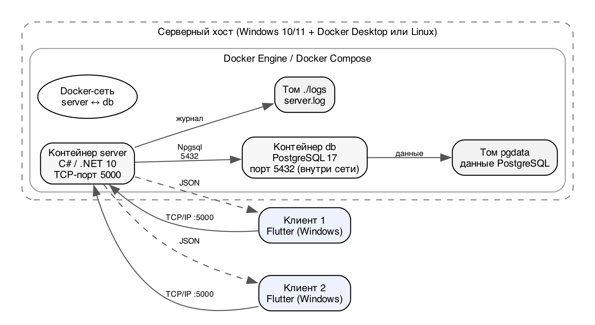

# Руководство администратора

Министерство науки и высшего образования Российской Федерации

Автономная некоммерческая организация профессиональная

образовательная организация Московский международный колледж

цифровых технологий «Академия ТОП»

Факультет Информационных систем и программирования

Кафедра Разработка программного обеспечения

| СОГЛАСОВАНО Руководитель проекта от кафедры, преподаватель _________ /Д. В. Золотухин / «___» ____________ 2026 г. | УТВЕРЖДАЮ Заведующий выпускающей кафедрой ________ / И. О. Фамилия / «___» ___________ 2026 г. |
| --- | --- |

# РУКОВОДСТВО АДМИНИСТРАТОРА

на разработку программного комплекса

# «Крестики и нолики»

Код документа: РА.001.2026

| Листов: 11 | Исполнители (разработчики): Студенты группы 9/3 – РПО 24/2 __________ / К. Д. Бызов/ «11» ноября 2026 г. |
| --- | --- |

МОСКВА — 2026 г.

# 1. Назначение и роли

Руководство администратора предназначено для специалиста, который развёртывает и сопровождает серверную часть программного комплекса «Крестики и нолики». Сервер и PostgreSQL работают в Docker-контейнерах; администратор управляет стеком через Docker Compose, командную строку сервера и клиент PostgreSQL.

В версии 1.0 отдельная панель администратора не предусмотрена. Управление выполняется через конфигурацию Docker Compose, команды docker compose, учётные записи PostgreSQL и журналы контейнера. Игровые сессии создаются игроками; администратор не вмешивается в ход партии, кроме остановки сервера или блокировки учётной записи.

Схема развёртывания: контейнер server и контейнер db находятся в одной Docker-сети; наружу опубликован только TCP-порт 5000 сервера. Клиенты подключаются к этому порту по локальной сети.

Схема приведена на рисунке 1.

Рисунок 1 — Схема развёртывания программного комплекса

# 2. Требования к серверу

Данные приведены в таблице 1.

Таблица 1 — Требования к серверу

| Компонент | Требование |
| --- | --- |
| Docker | Docker Engine 24+ и Docker Compose v2 (Docker Desktop, colima или Docker Engine на Linux) |
| Процессор | Не менее 2 ГГц |
| Оперативная память | Не менее 4 ГБ (рекомендуется 8 ГБ для Docker) |
| Свободное место | Не менее 3 ГБ для образов Docker, тома pgdata и резервных копий |
| Сеть | TCP/IP, статический адрес или разрешимое имя, опубликованный порт 5000 |
| Клиентские ПК | Windows 10/11 с Flutter-клиентом |

# 3. Развёртывание

Порядок развёртывания:

1. Установить Docker Engine и Docker Compose v2.

2. Получить каталог проекта с файлами docker-compose.yml и server/.

3. При необходимости изменить пароли и порт в docker-compose.yml.

4. Выполнить docker compose up -d --build.

5. Проверить состояние контейнеров и журнал сервера.

6. Разрешить входящий TCP-порт 5000 в межсетевом экране хоста.

Основные параметры приведены в таблице 2.

Таблица 2 — Параметры развёртывания

| Параметр | Значение по умолчанию | Назначение |
| --- | --- | --- |
| TTT_PORT | 5000 | Порт сервера внутри контейнера |
| TTT_DB_HOST | db | Имя сервиса PostgreSQL в Docker-сети |
| TTT_DB_PORT | 5432 | Порт PostgreSQL |
| TTT_DB_NAME | ttt | Имя базы данных |
| TTT_DB_USER | ttt | Пользователь базы данных |
| TTT_DB_PASSWORD | ttt | Пароль пользователя базы данных |
| TTT_LOG_FILE | /app/logs/server.log | Файл журнала сервера |
| pgdata | том Docker | Данные PostgreSQL |

Пароль по умолчанию ttt предназначен только для локального запуска. Перед эксплуатацией в сети смените пароль в docker-compose.yml и в параметрах подключения.

# 4. Запуск, остановка и журналы

Основные команды выполняются из корня проекта:

docker compose up -d --build   # запуск и сборка
docker compose ps              # состояние контейнеров
docker compose logs -f server  # журнал сервера
docker compose restart server  # перезапуск сервера
docker compose stop            # остановка без удаления
docker compose down            # остановка и удаление контейнеров

Данные PostgreSQL сохраняются в томе pgdata и не удаляются при docker compose down. Команда docker compose down -v удаляет и том — использовать только при полном сбросе.

Контейнер db имеет healthcheck pg_isready. Контейнер server запускается только после того, как база стала здоровой.

# 5. Управление учётными записями

Учётные записи создаются администратором. Пароль хранится в виде хеша с солью; открытый пароль не сохраняется. Команды выполняются через одноразовый контейнер сервера.

Данные приведены в таблице 3.

Таблица 3 — Операции с учётными записями

| Операция | Команда | Результат |
| --- | --- | --- |
| Создание | docker compose run --rm server --create-user player5 | Запись в Users и UserProfiles |
| Блокировка | docker compose run --rm server --block-user player5 | Пользователь не может войти |
| Разблокировка | docker compose run --rm server --unblock-user player5 | Вход разрешён |
| Сброс пароля | docker compose run --rm server --reset-password player5 | Новый пароль задаётся интерактивно |

Для неинтерактивного создания пользователя в скрипте используйте docker compose run --rm -T server --create-user login и передайте пароль и никнейм через стандартный ввод.

# 6. База данных

Схема создаётся автоматически при первом запуске сервера. Подключение к PostgreSQL:

docker compose exec db psql -U ttt -d ttt

Порт 5432 не публикуется на хост: доступ к базе возможен только из Docker-сети или через docker compose exec. Это снижает поверхность атаки.

Основные таблицы: Users, UserProfiles, GameSessions, GameResults, ChatMessages. Целостность обеспечивается первичными и внешними ключами.

# 7. Резервное копирование и восстановление

Резервная копия базы данных:

docker compose exec -T db pg_dump -U ttt -d ttt -F c > backup.dump

Восстановление:

docker compose exec -T db pg_restore -U ttt -d ttt -c < backup.dump

Рекомендуемый график приведён в таблице 4.

Таблица 4 — График резервного копирования

| Периодичность | Что копируется | Срок хранения |
| --- | --- | --- |
| Ежедневно | База данных (pg_dump) | 14 дней |
| Еженедельно | Полная копия базы и docker-compose.yml | 3 месяца |
| Перед обновлением | База данных и конфигурация | До следующего обновления |

Копии хранятся на другом носителе или сетевом ресурсе. Раз в месяц проверяется восстановление на тестовой базе.

# 8. Безопасность

– сменить пароль PostgreSQL по умолчанию;

– не публиковать порт 5432 на хост;

– ограничить доступ к порту 5000 доверенной локальной сетью;

– не передавать доступ к Docker-сокету непривилегированным пользователям;

– регулярно обновлять образы PostgreSQL и .NET;

– хранить резервные копии отдельно от рабочего тома;

– проверять журналы на аномальное число ошибок авторизации;

– учитывать, что после пяти неудачных попыток вход по логину блокируется на 60 секунд.

Протокол приложения не использует TLS; передача данных защищена только изоляцией локальной сети. Для выхода за пределы доверенного сегмента требуется дополнительный защищённый туннель, что не входит в версию 1.0.

# 9. Диагностика

Данные приведены в таблице 5.

Таблица 5 — Типовые проблемы

| Симптом | Проверка | Действие |
| --- | --- | --- |
| Контейнер server не запускается | docker compose logs server | Проверить конфигурацию и подключение к db |
| db не становится healthy | docker compose logs db | Проверить пароль, том и свободное место |
| Клиенты не подключаются | docker compose ps, порт 5000 | Проверить публикацию порта и межсетевой экран |
| Медленная работа | docker stats, свободное место | Выделить ресурсы, очистить журналы |
| Ошибка записи результата | docker compose logs server | Проверить права и состояние тома pgdata |
| Потеря данных | Том pgdata, резервные копии | Восстановить из копии, проверить том |

# 10. Обновление версии

1. Сделать резервную копию базы и сохранить docker-compose.yml.

2. Получить новую версию файлов проекта.

3. Выполнить docker compose up -d --build.

4. Проверить docker compose ps и журнал сервера.

5. Подключить тестового клиента и провести контрольную партию.

6. При ошибке вернуть предыдущие файлы и восстановить базу из копии.

После обновления проверяются авторизация, создание сессии, ход, чат и запись результата. Информация об изменениях заносится в формуляр.
