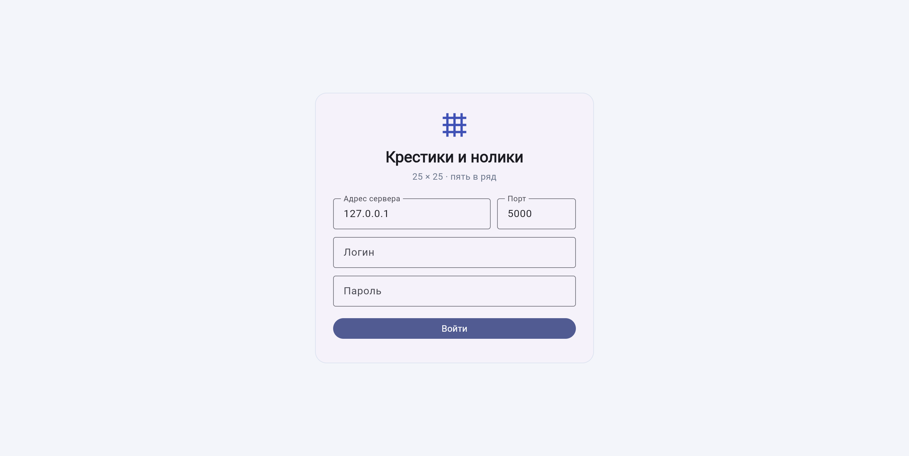
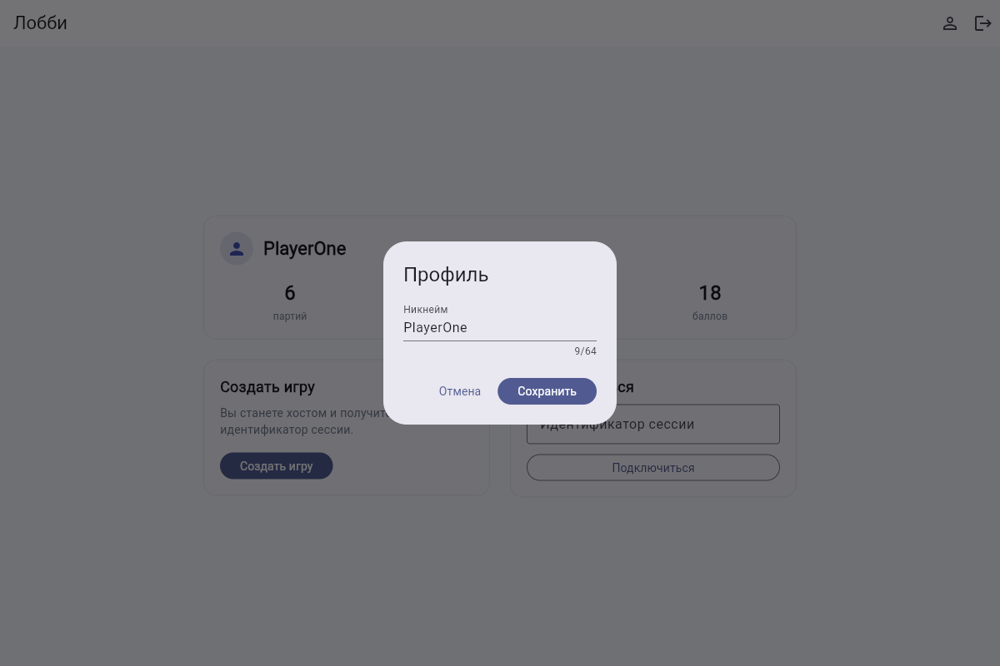
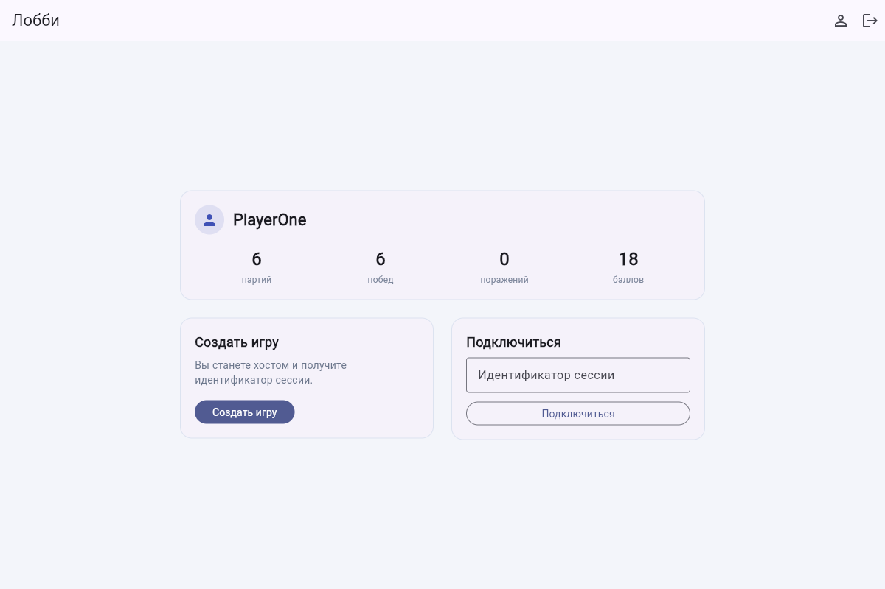
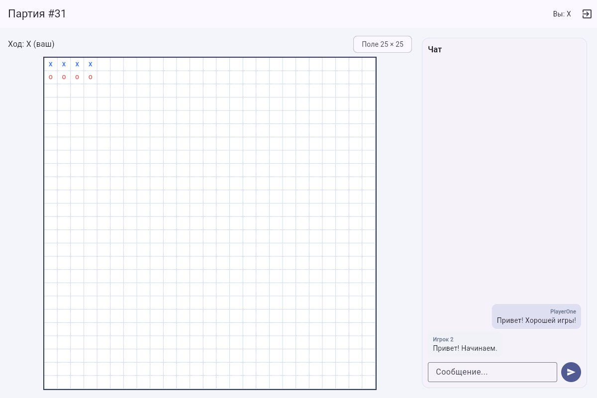
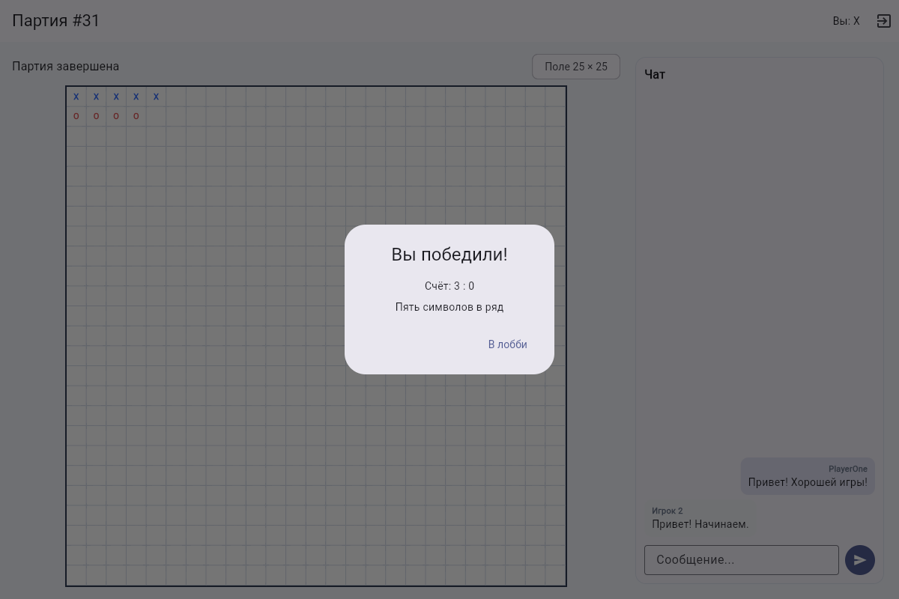

# Руководство пользователя

Министерство науки и высшего образования Российской Федерации

Автономная некоммерческая организация профессиональная

образовательная организация Московский международный колледж

цифровых технологий «Академия ТОП»

Факультет Информационных систем и программирования

Кафедра Разработка программного обеспечения

| СОГЛАСОВАНО Руководитель проекта от кафедры, преподаватель _________ /Д. В. Золотухин / «___» ____________ 2026 г. | УТВЕРЖДАЮ Заведующий выпускающей кафедрой ________ / И. О. Фамилия / «___» ___________ 2026 г. |
| --- | --- |

# РУКОВОДСТВО ПОЛЬЗОВАТЕЛЯ

на разработку программного комплекса

# «Крестики и нолики»

Код документа: РП.001.2026

| Листов: 10 | Исполнители (разработчики): Студенты группы 9/3 – РПО 24/2 __________ / К. Д. Бызов/ «11» ноября 2026 г. |
| --- | --- |

МОСКВА — 2026 г.

# СОДЕРЖАНИЕ

## 1. Назначение программы	3

## 2. Условия выполнения программы	4

## 3. Выполнение программы	5

3.1. Авторизация	5

3.2. Профиль пользователя	5

3.3. Лобби: создание и подключение к игре	6

3.4. Игровое поле и выполнение ходов	7

3.5. Чат	8

3.6. Завершение партии	8

3.7. Завершение работы	9

## 4. Сообщения оператору	10

4.1. Сообщения пользователю	10

4.2. Возможные неисправности	10

# 1. Назначение программы

Руководство пользователя предназначено для игроков, использующих программный комплекс «Крестики и нолики». Программа позволяет двум пользователям провести сетевую партию на поле 25 × 25, обменяться сообщениями в чате, изменить профиль и посмотреть итоговый счёт.

Для работы необходимы: персональный компьютер под управлением Windows 10/11, клиентское приложение, доступ к локальной сети и запущенный сервер. Адрес сервера и порт сообщает администратор. Базовые навыки работы с клавиатурой и мышью достаточны для освоения программы.

В одной игровой сессии участвуют два игрока. Список друзей и мини-игра выбора первого хода в версии 1.0 отсутствуют: для подключения используется идентификатор сессии, который сообщает соперник.

# 2. Условия выполнения программы

Порядок подготовки:

1. Убедитесь, что компьютер подключён к локальной сети.

2. Запустите клиентское приложение.

3. Введите адрес сервера и порт, если они не заданы по умолчанию.

4. Дождитесь открытия экрана авторизации.

Если сервер недоступен, клиент выводит сообщение о потере соединения. Проверьте адрес, порт и доступность сервера; при необходимости обратитесь к администратору.

# 3. Выполнение программы

## 3.1. Авторизация

На экране авторизации введите логин и пароль, выданные администратором, и нажмите «Войти» (рисунок 1).

Рисунок 1 — Экран авторизации

При успешном входе открывается лобби. Если логин или пароль введены неверно, выводится сообщение «Неверный логин или пароль». Пустые поля не отправляются на сервер: программа просит заполнить оба поля.

Пароль чувствителен к регистру. Не сообщайте пароль другим игрокам; администратор не запрашивает пароль в чате или по телефону.

## 3.2. Профиль пользователя

В лобби отображаются никнейм и статистика: количество партий, побед, поражений и итоговый счёт. Для изменения никнейма нажмите иконку профиля в правом верхнем углу, введите новое имя и нажмите «Сохранить» (рисунок 2).

Рисунок 2 — Редактирование профиля

Никнейм не может быть пустым или состоять только из пробелов. После сохранения изменения отображаются в лобби и в игровой сессии. Статистика обновляется автоматически после завершения каждой партии.

## 3.3. Лобби: создание и подключение к игре

В лобби доступны две возможности: создать новую игру или подключиться к существующей по идентификатору (рисунок 3).

Рисунок 3 — Лобби

Создание игры:

1. Нажмите «Создать игру».

2. Сервер создаст сессию и покажет её идентификатор.

3. Сообщите идентификатор сопернику.

4. Дождитесь подключения второго игрока.

Подключение к игре:

1. Введите идентификатор сессии, полученный от соперника.

2. Нажмите «Подключиться».

3. После подключения откроется игровое поле.

К занятой сессии третий игрок подключиться не может: сервер выводит сообщение «Сессия заполнена». Если идентификатор введён неверно, появляется сообщение «Сессия не найдена».

## 3.4. Игровое поле и выполнение ходов

Игровое поле имеет размер 25 × 25 клеток (рисунок 4). Один игрок играет символом X, второй — символом O. В верхней части экрана отображается номер партии и индикатор очереди.

Рисунок 4 — Игровое поле и чат

Чтобы выполнить ход, щёлкните по свободной клетке. Клиент отправит координаты серверу, а поле обновится только после подтверждения. Поле у соперника обновляется в тот же момент.

Правила и ограничения:

– первый ход выполняет игрок X;

– ходы выполняются строго по очереди;

– нельзя выбрать занятую клетку;

– координаты клетки находятся в диапазоне 0–24;

– побеждает игрок, собравший пять своих символов подряд по горизонтали, вертикали или диагонали;

– если поле заполнено, а линии из пяти нет, фиксируется ничья.

При попытке хода не в свою очередь выводится сообщение «Сейчас ход другого игрока», при выборе занятой клетки — «Клетка уже занята». Состояние поля при ошибке не изменяется.

## 3.5. Чат

Чат расположен справа от игрового поля. Введите сообщение в поле ввода и нажмите кнопку отправки. Сообщение отображается у обоих участников сессии.

Пустые сообщения не отправляются. Нецензурные слова фильтруются сервером и заменяются символами «***»; исходный текст сопернику не передаётся. Не отправляйте в чат персональные данные и пароли.

## 3.6. Завершение партии

Партия завершается победой одного из игроков или ничьей. В диалоге результатов отображаются победитель и итоговый счёт (рисунок 5). При выходе участника или потере связи партия отменяется, диалог результатов не показывается.

Рисунок 5 — Результат партии

Начисление баллов: 3 балла за победу, 1 балл за ничью, 0 баллов за поражение. После завершения партии можно создать новую игру или выйти из программы. При выходе во время партии продолжение блокируется, соперник получает уведомление.

## 3.7. Завершение работы

Для выхода из программы закройте окно клиента или выберите «Выход» в меню. Если партия активна, сервер уведомит соперника и заблокирует продолжение. Перед завершением работы рекомендуется доиграть партию или корректно выйти из игры.

# 4. Сообщения оператору

## 4.1. Сообщения пользователю

Данные приведены в таблице 1.

Таблица 1 — Основные сообщения

| Сообщение | Причина | Что делать |
| --- | --- | --- |
| Неверный логин или пароль | Ошибка в учётных данных | Проверить логин и пароль |
| Заполните логин и пароль | Пустые поля | Заполнить оба поля |
| Сессия не найдена | Неверный идентификатор | Проверить номер сессии |
| Сессия заполнена | В сессии уже два игрока | Создать новую сессию |
| Сейчас ход другого игрока | Нарушена очередь | Дождаться своего хода |
| Клетка уже занята | Выбрана занятая клетка | Выбрать свободную клетку |
| Координаты вне диапазона | Клетка за пределами поля | Выбрать клетку в диапазоне 0–24 |
| Партия завершена | Сессия закрыта | Создать новую партию |
| Соединение потеряно | Обрыв сети или остановка сервера | Проверить сеть и перезапустить клиент |

## 4.2. Возможные неисправности

Данные приведены в таблице 2.

Таблица 2 — Возможные неисправности и способы устранения

| Симптом | Вероятная причина | Способ устранения |
| --- | --- | --- |
| Клиент не запускается | Клиентское приложение не установлено или повреждено | Переустановить клиент, обратиться к администратору |
| Не удаётся подключиться к серверу | Неверный адрес/порт, сервер остановлен, порт закрыт | Проверить адрес и порт, сообщить администратору |
| Поле не обновляется | Потеря соединения | Проверить сеть, перезапустить клиент |
| Сообщение в чат не отправляется | Пустой текст или нет соединения | Ввести текст, проверить соединение |
| Не отображается статистика | Ошибка базы данных | Сообщить администратору |
