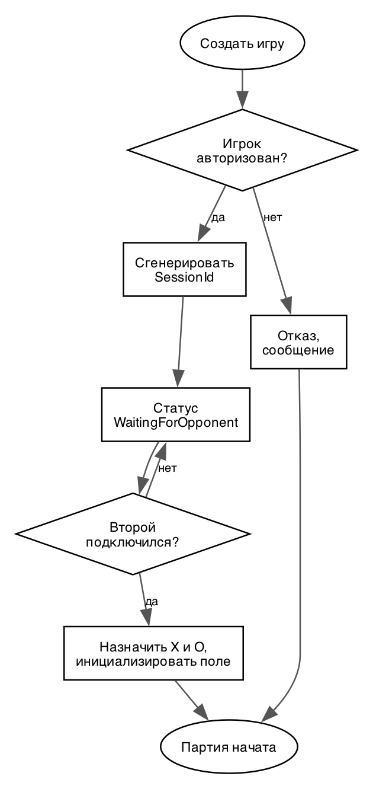
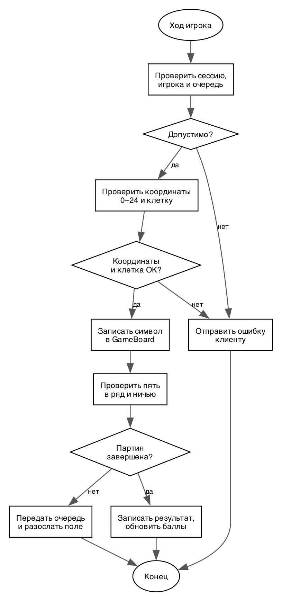
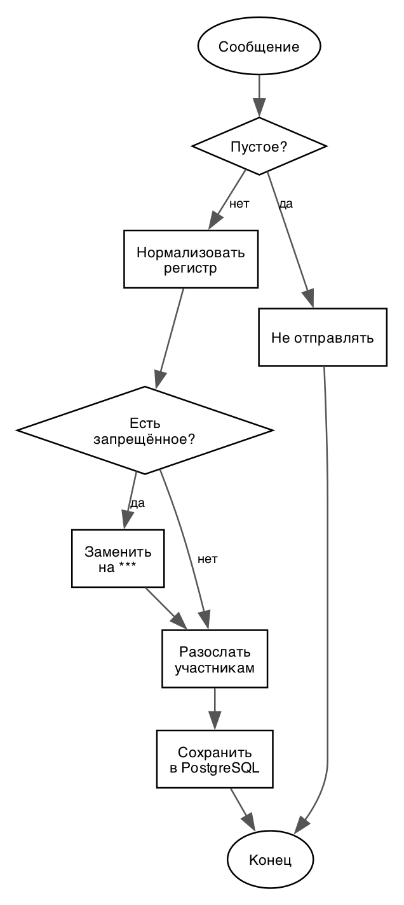
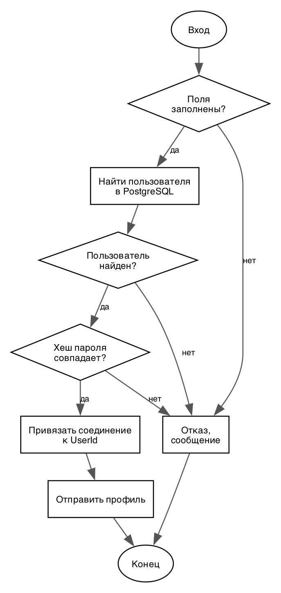

# Схема алгоритма и программы

## 1. Перечень алгоритмов программы

В состав программы входят алгоритмы, обеспечивающие авторизацию, управление игровыми сессиями, обработку ходов, проверку победы, фильтрацию сообщений и подсчёт баллов. Перечень приведён в таблице 1.

Таблица 1 — Перечень основных алгоритмов

| № | Алгоритм | Назначение | Вход | Выход |
| --- | --- | --- | --- | --- |
| A1 | Авторизация | Проверка учётных данных и привязка соединения | Логин, пароль | Профиль, идентификатор |
| A2 | Создание сессии | Создание комнаты и ожидание соперника | Идентификатор игрока | SessionId, статус |
| A3 | Подключение к сессии | Добавление второго игрока и запуск партии | SessionId, игрок | Активная сессия |
| A4 | Обработка хода | Валидация и применение хода к полю 25 × 25 | SessionId, координаты | Новое состояние поля |
| A5 | Проверка победы | Поиск пяти символов в ряд и ничьей | Поле, последний ход | Победитель или ничья |
| A6 | Фильтрация сообщений чата | Замена запрещённых слов | Текст сообщения | Отфильтрованный текст |
| A7 | Подсчёт баллов | Обновление статистики и итогового счёта | Результат партии | Баллы, запись в БД |

## 2. Разбор каждого алгоритма

### 2.1. Алгоритм авторизации

Алгоритм проверяет заполненность полей, ищет пользователя в PostgreSQL, сравнивает хеш пароля и привязывает текущее соединение к идентификатору пользователя.

```
ФУНКЦИЯ Login(login, password)
  ЕСЛИ login = &quot;&quot; ИЛИ password = &quot;&quot;: ОШИБКА &quot;Заполните поля&quot;
  ЕСЛИ AuthThrottle.IsLocked(login): ОШИБКА &quot;Слишком много попыток&quot;
  user = SELECT * FROM Users WHERE Login = login
  ЕСЛИ user = NULL: ОШИБКА &quot;Неверный логин или пароль&quot;
  ЕСЛИ user.IsBlocked: ОШИБКА &quot;Неверный логин или пароль&quot;
  ЕСЛИ НЕ Verify(password, user.PasswordHash):
      AuthThrottle.RecordFailure(login)
      ОШИБКА &quot;Неверный логин или пароль&quot;
  AuthThrottle.Reset(login)
  connection.UserId = user.UserId
  ВЕРНУТЬ LoadProfile(user.UserId)
```

### 2.2. Алгоритм создания сессии

Создаётся уникальный идентификатор комнаты, первый игрок назначается хостом, поле инициализируется пустыми клетками, статус — ожидание.

```
ФУНКЦИЯ CreateSession(userId)
  ЕСЛИ userId НЕ авторизован: ОШИБКА
  sessionId = INSERT INTO GameSessions
      (PlayerXId, BoardState, CurrentTurn, Status)
      VALUES (userId, EmptyBoardJson, 1, &#x27;WaitingForOpponent&#x27;)
      RETURNING SessionId
  session = { id: sessionId, playerX: userId,
              playerO: NULL,
              board: EmptyBoard(25, 25),
              turn: X, status: WAITING }
  sessions[sessionId] = session
  ВЕРНУТЬ sessionId
```

### 2.3. Алгоритм подключения второго игрока

Сервер проверяет существование сессии, её свободность и статус, добавляет второго игрока, назначает символы X и O и переводит сессию в активное состояние.

```
ФУНКЦИЯ JoinSession(sessionId, userId)
  session = sessions[sessionId]
  ЕСЛИ session = NULL: ОШИБКА &quot;Сессия не найдена&quot;
  ЕСЛИ session.playerO &lt;&gt; NULL: ОШИБКА &quot;Сессия заполнена&quot;
  updated = UPDATE GameSessions
      SET PlayerOId = userId, Status = &#x27;Active&#x27;
      WHERE SessionId = sessionId
        AND Status = &#x27;WaitingForOpponent&#x27;
        AND PlayerOId IS NULL
  ЕСЛИ updated = 0: ОШИБКА &quot;Сессия уже заполнена&quot;
  session.playerO = userId
  session.status = ACTIVE
  session.turn = X
  Broadcast(session, &quot;start&quot;)
  ВЕРНУТЬ session
```

### 2.4. Алгоритм обработки хода

Алгоритм проверяет сессию, участника, очередь, диапазон координат 0–24 и свободность клетки, записывает символ, проверяет завершение партии и рассылает состояние.

```
ФУНКЦИЯ MakeMove(sessionId, userId, row, col)
  session = sessions[sessionId]
  ЕСЛИ session = NULL ИЛИ session.status &lt;&gt; ACTIVE: ОШИБКА &quot;Партия завершена&quot;
  ЕСЛИ userId НЕ В session.players: ОШИБКА &quot;Вы не участник сессии&quot;
  symbol = session.symbols[userId]
  ЕСЛИ session.turn &lt;&gt; symbol: ОШИБКА &quot;Сейчас ход другого игрока&quot;
  ЕСЛИ row &lt; 0 ИЛИ row &gt; 24 ИЛИ col &lt; 0 ИЛИ col &gt; 24:
      ОШИБКА &quot;Координаты вне диапазона&quot;
  ЕСЛИ session.board[row][col] &lt;&gt; EMPTY: ОШИБКА &quot;Клетка уже занята&quot;
  session.board[row][col] = symbol
  ЕСЛИ CheckWin(session, row, col, symbol):
      FinishGame(session, symbol)
  ИНАЧЕ ЕСЛИ IsFull(session.board):
      FinishGame(session, DRAW)
  ИНАЧЕ:
      session.turn = (O ЕСЛИ symbol = X ИНАЧЕ X)
      UPDATE GameSessions
          SET BoardState = BoardToJson(session.board),
              CurrentTurn = session.turn, Status = &#x27;Active&#x27;
          WHERE SessionId = sessionId AND Status = &#x27;Active&#x27;
  Broadcast(session, &quot;state&quot;)
  ВЕРНУТЬ OK
```

### 2.5. Алгоритм определения победителя

Проверка выполняется вокруг последнего хода по четырём направлениям. Счётчик увеличивается, пока соседние клетки содержат тот же символ; при достижении пяти фиксируется победа.

```
ФУНКЦИЯ CheckWin(session, row, col, symbol)
  ДЛЯ (dr, dc) В [(0,1), (1,0), (1,1), (1,-1)]:
      count = 1
      count += Count(row, col, dr, dc, symbol)
      count += Count(row, col, -dr, -dc, symbol)
      ЕСЛИ count &gt;= 5: ВЕРНУТЬ TRUE
  ВЕРНУТЬ FALSE

ФУНКЦИЯ Count(row, col, dr, dc, symbol)
  n = 0
  r = row + dr; c = col + dc
  ПОКА ВНУТРИ_ПОЛЯ(r, c) И board[r][c] = symbol:
      n = n + 1; r = r + dr; c = c + dc
  ВЕРНУТЬ n
```

### 2.6. Алгоритм обработки сообщений чата и фильтрации

Текст сообщения чата проверяется регистронезависимо, для каждого слова словаря строится шаблон с разделителями и похожими символами, найденные фрагменты заменяются на «***», после чего сообщение рассылается и сохраняется.

```
ФУНКЦИЯ Filter(text)
  ЕСЛИ Trim(text) = &quot;&quot;: ВЕРНУТЬ NULL
  ДЛЯ каждого word В Dictionary:
      pattern = BuildPattern(word)
      text = RegexReplace(text, pattern, &quot;***&quot;)
  ВЕРНУТЬ text

ФУНКЦИЯ BuildPattern(word)
  pattern = &quot;&quot;
  ДЛЯ каждого символа c В word:
      ЕСЛИ pattern &lt;&gt; &quot;&quot;: pattern = pattern + &quot;[\s\p{P}\p{S}]*&quot;
      pattern = pattern + CharacterClass(c)  // похожие буквы и цифры
  ВЕРНУТЬ pattern
```

### 2.7. Алгоритм подсчёта баллов

После завершения партии результат и статистика обновляются в одной транзакции PostgreSQL. Победа даёт 3 балла, ничья — 1, поражение — 0.

```
ФУНКЦИЯ FinishGame(session, winnerSymbol)
  ЕСЛИ winnerSymbol = X:
      bonusX = 3; bonusO = 0; winnerId = session.playerX
  ИНАЧЕ ЕСЛИ winnerSymbol = O:
      bonusX = 0; bonusO = 3; winnerId = session.playerO
  ИНАЧЕ:
      bonusX = 1; bonusO = 1; winnerId = NULL

  BEGIN TRANSACTION
  inserted = INSERT INTO GameResults
      (SessionId, WinnerId, ResultType)
      VALUES (session.id, winnerId,
              CASE WHEN winnerId IS NULL THEN &#x27;Draw&#x27; ELSE &#x27;Win&#x27; END)
      ON CONFLICT (SessionId) DO NOTHING
      RETURNING ResultId
  ЕСЛИ inserted &lt;&gt; NULL:
      UPDATE UserProfiles
          SET GamesPlayed = GamesPlayed + 1,
              Wins = Wins +
                  (CASE WHEN winnerId = session.playerX THEN 1 ELSE 0 END),
              Losses = Losses +
                  (CASE WHEN winnerId = session.playerO THEN 1 ELSE 0 END),
              TotalScore = TotalScore + bonusX
          WHERE UserId = session.playerX
      UPDATE UserProfiles
          SET GamesPlayed = GamesPlayed + 1,
              Wins = Wins +
                  (CASE WHEN winnerId = session.playerO THEN 1 ELSE 0 END),
              Losses = Losses +
                  (CASE WHEN winnerId = session.playerX THEN 1 ELSE 0 END),
              TotalScore = TotalScore + bonusO
          WHERE UserId = session.playerO
  UPDATE GameSessions
      SET BoardState = BoardToJson(session.board),
          Status = &#x27;Finished&#x27;, FinishedAt = NOW()
      WHERE SessionId = session.id
  COMMIT
  SendResult(session, bonusX, bonusO)
```

## 3. Создание блок-схем для ключевых алгоритмов

### 3.1. Создание сессии

Алгоритм отвечает за создание изолированной игровой сессии и является ключевым, потому что с него начинается любая партия. Переменные алгоритма приведены в таблице 2.

Таблица 2 — Переменные алгоритма создания сессии

| Имя | Тип | Область видимости | Назначение |
| --- | --- | --- | --- |
| sessionId | int | объект session | Уникальный номер сессии |
| playerX, playerO | int | объект session | Идентификаторы игроков |
| board | int[25,25] | объект session | Состояние поля: 0, 1, 2 |
| turn | int | объект session | Очередь: 1 — X, 2 — O |
| status | enum | объект session | Статус сессии |

Схема приведена на рисунке 1.



Рисунок 1 — Алгоритм создания сессии

### 3.2. Подключение второго игрока

Алгоритм проверяет существование и свободность сессии, фиксирует второго игрока в GameSessions и переводит сессию в Active. Блок-схема приведена на рисунке 2.


Рисунок 2 — Алгоритм подключения второго игрока

### 3.3. Обработка хода

Алгоритм проверяет допустимость хода и синхронизирует состояние поля. Переменные алгоритмов хода и проверки победы приведены в таблице 3.

Таблица 3 — Переменные алгоритмов хода и проверки победы

| Имя | Тип | Область видимости | Назначение |
| --- | --- | --- | --- |
| sessionId | int | локальная | Идентификатор игровой сессии |
| userId | int | локальная | Идентификатор игрока |
| row, col | int | локальная | Координаты клетки (0–24) |
| symbol | int | локальная | Символ: 1 — X, 2 — O |
| dr, dc | int | локальная | Направление проверки |
| count | int | локальная | Количество символов подряд |
| session | GameSession | локальная | Состояние партии |

Схема приведена на рисунке 3.



Рисунок 3 — Алгоритм обработки хода и синхронизации

### 3.4. Проверка победы и ничьей

Алгоритм определяет завершение партии по пяти символам в ряд или по заполнению поля. Блок-схема приведена на рисунке 4.



Рисунок 4 — Алгоритм проверки победы и ничьей

### 3.5. Фильтрация сообщений чата

Алгоритм заменяет запрещённые выражения с учётом разделителей и похожих символов. Переменные приведены в таблице 4.

Таблица 4 — Переменные алгоритма фильтрации

| Имя | Тип | Область видимости | Назначение |
| --- | --- | --- | --- |
| text | string | локальная | Исходный текст сообщения |
| pattern | string | локальная | Шаблон поиска с разделителями |
| word | string | локальная | Очередное слово словаря |
| dictionary | string[] | глобальная | Словарь запрещённых слов |

Схема приведена на рисунке 5.


Рисунок 5 — Алгоритм обработки и фильтрации сообщений

### 3.6. Авторизация

Алгоритм проверяет учётные данные, блокировку и лимит попыток, после чего привязывает соединение к пользователю. Блок-схема приведена на рисунке 6.



Рисунок 6 — Алгоритм авторизации

## 4. Заключение

Схемы алгоритмов оформлены с учётом ГОСТ 19.701-90: используются блоки «начало/конец», «процесс», «решение», «данные» и «документ». Линии потока направлены сверху вниз или слева направо; каждое ветвление подписано «да» или «нет». Подписи рисунков размещены под изображениями.

Псевдокод приведён для однозначного понимания логики и не зависит от конкретного языка реализации. Имена переменных совпадают с именами в пояснительной записке и описании программы.
