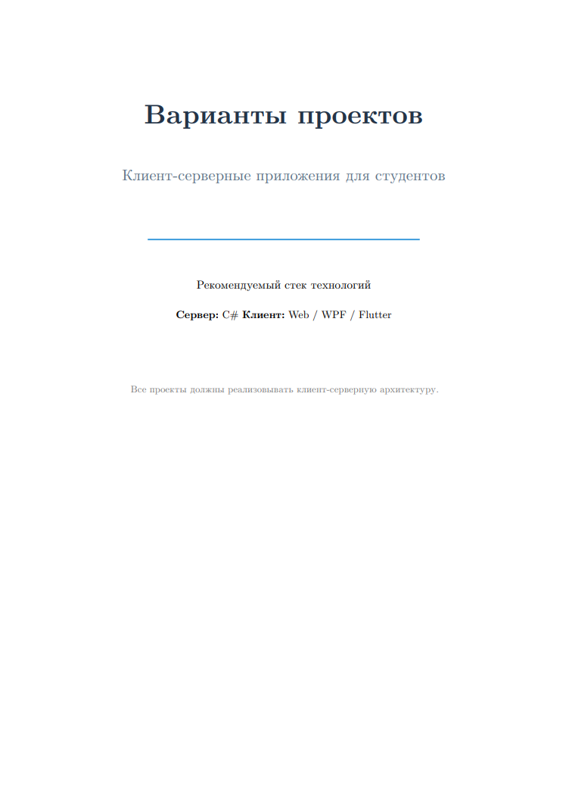
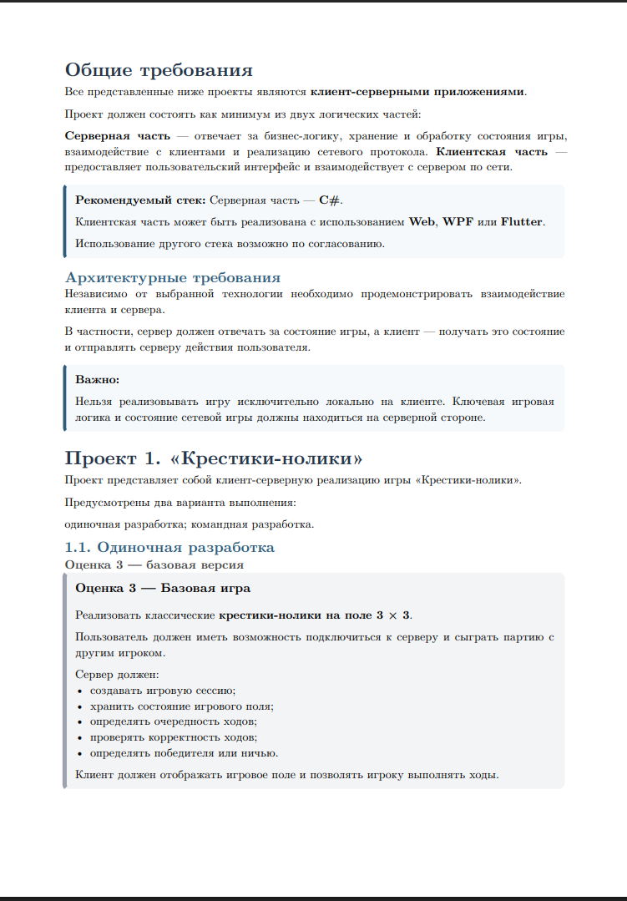
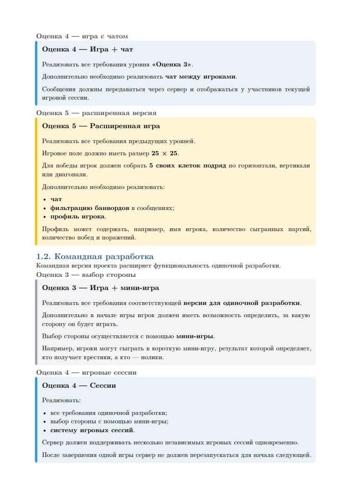
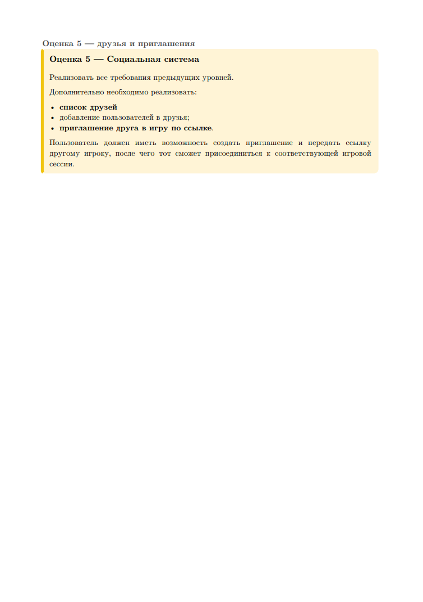
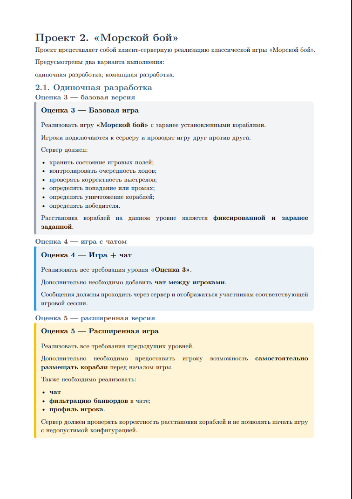
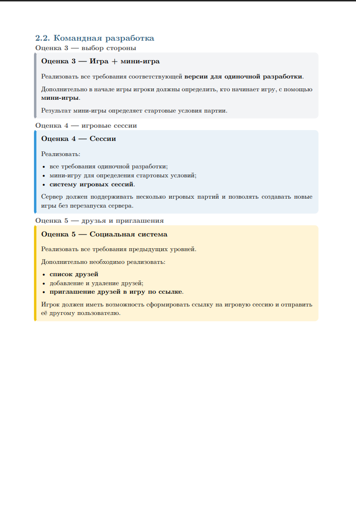
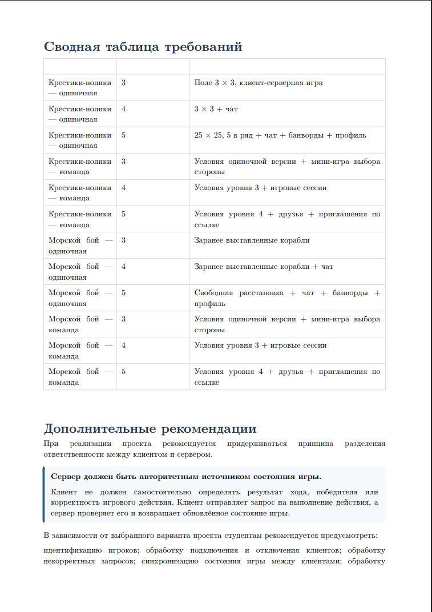

# Техническое задание

Министерство науки и высшего образования Российской Федерации

Автономная некоммерческая организация профессиональная

образовательная организация Московский международный колледж

цифровых технологий «Академия ТОП»

Факультет Информационных систем и программирования

Кафедра Разработка программного обеспечения

| СОГЛАСОВАНО Руководитель проекта от кафедры, преподаватель _________ /Д. В. Золотухин / «___» ____________ 2026 г. | УТВЕРЖДАЮ Заведующий выпускающей кафедрой ________ / И. О. Фамилия / «___» ___________ 2026 г. |
| --- | --- |

# ТЕХНИЧЕСКОЕ ЗАДАНИЕ

на разработку программного комплекса

# «Крестики и нолики»

| Листов: 18 | Исполнители (разработчики): Студенты группы 9/3 – РПО 24/2 __________ / К. Д. Бызов/ «18» сентября 2026 г. |
| --- | --- |

МОСКВА — 2026 г.

# 1. Введение

Наименование программы: клиент-серверная программа «Крестики и нолики» (далее — Программа). Область применения: организация сетевой партии двух игроков на персональных компьютерах в локальной сети. Программа реализует расширенный вариант классической игры: поле 25 × 25, победа — пять одинаковых символов подряд по горизонтали, вертикали или диагонали.

Программа предназначена для учебных и демонстрационных целей, а также для использования в локальной сети небольшой организации. Она показывает полный цикл клиент-серверного взаимодействия: авторизацию, создание сессии, синхронизацию поля, чат, фильтрацию сообщений и сохранение результатов.

# 2. Основания для разработки

Основанием для разработки является задание по дисциплине «Технология разработки программного обеспечения», переданное исполнителю согласно документу от 10 сентября 2026 года и утверждённое руководителем проекта от кафедры. Страницы задания приведены на рисунках 1–8 приложения 1.

# 3. Назначение разработки

Программный комплекс — клиент-серверная система для проведения партии в «Крестики и нолики» между двумя пользователями. Функциональное назначение включает авторизацию, создание и редактирование профиля, создание игровых сессий, подключение второго игрока по идентификатору, обмен ходами, чат с фильтрацией нецензурных слов, подсчёт баллов и отображение итогового счёта.

Эксплуатационное назначение — практическое применение навыков сетевого программирования: проектирование прикладного протокола, синхронизация игрового состояния в реальном времени, построение клиент-серверной архитектуры и хранение данных в PostgreSQL.

# 4. Требования к программе

## 4.1. Требования к функциональным характеристикам

Программа должна обеспечивать выполнение следующих функций:

– авторизация пользователей по логину и паролю;

– создание и редактирование профиля игрока (никнейм, статистика);

– создание игровой сессии и подключение второго игрока по идентификатору;

– отображение игрового поля размером 25 × 25 клеток;

– выполнение ходов с проверкой очереди, диапазона 0–24 и свободной клетки;

– определение победы при пяти одинаковых символах в ряд по горизонтали, вертикали или диагонали;

– определение ничьей при заполнении всех 625 клеток;

– сохранение текущего состояния поля и синхронизация его с обоими клиентами;

– чат двух игроков с серверной фильтрацией нецензурных слов;

– автоматический подсчёт баллов: 3 за победу, 1 за ничью, 0 за поражение;

– отображение итогового счёта и обновление статистики профиля;

– корректное завершение партии при выходе или потере соединения одного из игроков.

В объём версии 1.0 не входят мини-игра выбора первого хода, список друзей, приглашения и панель администратора.

Входными данными являются: учётные данные пользователя, команды создания и подключения к сессии, координаты выбранной клетки, сообщения чата, команда выхода. Выходными данными являются: состояние игрового поля, очередь хода, сообщения чата, результат партии, баллы и статистика профиля, коды ошибок.

Временные характеристики: передача изменений игрового состояния между сервером и клиентами должна выполняться в режиме реального времени; время от отправки хода до отображения у второго клиента в локальной сети не должно превышать 1 секунды.

## 4.2. Требования к надёжности

Программа должна блокировать некорректные действия пользователя: выбор занятой клетки, ход не в свою очередь, координаты вне диапазона, попытку продолжить завершённую партию, пустое или слишком длинное сообщение чата. На каждое такое действие должно выдаваться информационное сообщение с кодом ошибки, а состояние поля не должно изменяться.

Сервер должен обеспечивать одновременное подключение нескольких пользователей и нескольких независимых игровых сессий. Ошибка или выход одного клиента не должны влиять на другие сессии. При потере соединения партия корректно завершается, а соперник получает уведомление.

Сервер должен проверять все команды независимо от клиентских проверок, использовать параметризованные запросы к базе данных и хеширование паролей с солью. Соединение не защищено TLS и предназначено для доверенной локальной сети.

## 4.3. Условия эксплуатации

Для работы с программой пользователь должен иметь базовые навыки взаимодействия с персональным компьютером: умение запускать программы, пользоваться клавиатурой и мышью, работать с элементами графического интерфейса. Администратор должен уметь запускать Docker Compose, просматривать журналы и выполнять команды управления учётными записями.

## 4.4. Требования к составу технических средств

Клиентская часть: процессор с частотой не менее 1,5 ГГц, оперативная память не менее 2 ГБ, свободное место на диске не менее 50 МБ, сетевое подключение к серверу.

Серверная часть: процессор с частотой не менее 2 ГГц, оперативная память не менее 4 ГБ, свободное место на диске не менее 3 ГБ для образов Docker, базы данных и резервных копий. Для работы требуется Docker Engine и Docker Compose v2; на Windows — Docker Desktop с Linux-контейнерами.

## 4.5. Требования к информационной и программной совместимости

Клиентская часть предназначена для операционных систем Windows 10/11 x64; предусмотрена также веб-сборка Flutter. Серверная часть работает в Linux-контейнере Docker; на Windows используется Docker Desktop с Linux-контейнерами, на Linux — Docker Engine.

Технологический стек: сервер — C# / .NET 10; клиент — Flutter / Dart; база данных — PostgreSQL 15 и выше; обмен данными — TCP/IP, JSON-сообщения, разделённые символом перевода строки; развёртывание — Docker Compose.

Сервер принимает TCP-подключения на порту 5000. Программа должна корректно обрабатывать кириллицу в UTF-8, не требовать установки Flutter SDK на компьютер пользователя (release-сборка содержит необходимые библиотеки) и не публиковать порт PostgreSQL во внешнюю сеть.

# 5. Требования к программной документации

В полный комплект программной документации должны входить:

– техническое задание;

– пояснительная записка;

– текст исходного кода программы;

– схема алгоритма и программы;

– описание программы;

– описание применения;

– руководство пользователя;

– руководство администратора;

– руководство по техническому обслуживанию;

– ведомость эксплуатационных документов;

– программа и методика испытаний;

– формуляр;

– протоколы испытаний;

– технический отчёт о создании и тестировании прототипа;

– акт приёмки и ввода в эксплуатацию.

# 6. Стадии и этапы разработки

Стадии и этапы разработки приведены в таблице 1.

Таблица 1 — Стадии и этапы разработки

| № | Стадия разработки (ГОСТ 19.102-77) | Содержание работ | Сроки выполнения |
| --- | --- | --- | --- |
| 1 | Техническое задание | Постановка задачи, сбор требований, утверждение ТЗ | 14.09–18.09 |
| 2 | Эскизный и технический проект | Проектирование клиент-серверной архитектуры, структур данных и алгоритмов | 19.09–30.09 |
| 3 | Рабочий проект | Написание кода, модульное и интеграционное тестирование, отладка | 01.10–22.11 |
| 4 | Внедрение (сдача работы) | Оформление документации, испытания, защита проекта | 30.11–04.12 |

# 7. Порядок контроля и приёмки

Контроль и приёмка Программы проводятся в следующем порядке:

– запуск серверной части и базы данных через Docker Compose;

– подключение клиентов и авторизация пользователей;

– создание игровой сессии и подключение второго игрока;

– выполнение ходов и синхронизация состояния поля;

– блокировка некорректных ходов;

– определение победы и ничьей;

– работа чата и фильтрация нецензурной лексики;

– создание и редактирование профиля;

– начисление баллов и обновление статистики;

– выход игрока и корректное завершение партии;

– работа нескольких параллельных сессий.

Критерием успешной приёмки является выполнение всех перечисленных проверок, отсутствие аварийного завершения сервера при некорректных действиях клиента и совпадение фактического числа листов с указанным на титульном листе.

# ПРИЛОЖЕНИЕ 1

Страницы задания на разработку приведены на рисунках 1–8. Каждая страница показана отдельно: рисунок 1, рисунок 2, рисунок 3, рисунок 4, рисунок 5, рисунок 6, рисунок 7, рисунок 8.

Рисунок 1 — Страница 1 задания

Рисунок 2 — Страница 2 задания

Рисунок 3 — Страница 3 задания

Рисунок 4 — Страница 4 задания

Рисунок 5 — Страница 5 задания

Рисунок 6 — Страница 6 задания

Рисунок 7 — Страница 7 задания

Рисунок 8 — Страница 8 задания
